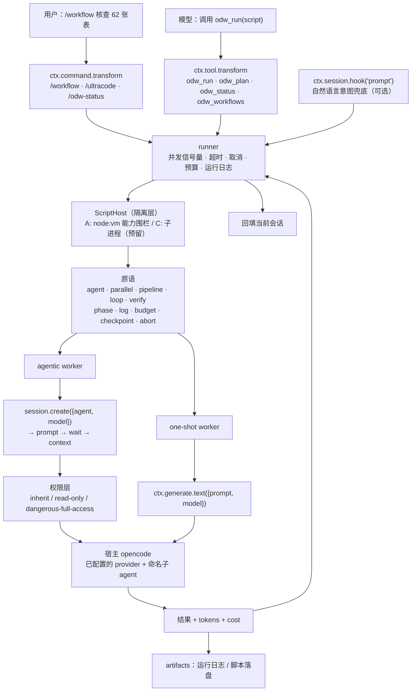
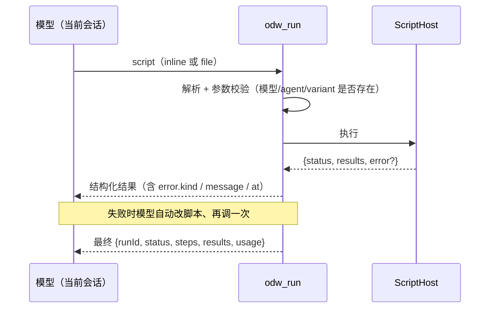

# opencode-dynamic-workflow — 实施计划

> TypeScript（strict）的 opencode v2 插件，把「动态工作流」做成 opencode 内的一等公民。
> 本计划的所有关键 API 事实均由**会话内实测**得到（见 §3），不是从文档推断的。

---

## 0. 一句话

一个 opencode v2 插件：模型写一段受限脚本 `async (ctx) => {...}`，由插件用 `agent / parallel / pipeline / loop / verify / phase / log / budget / checkpoint` 原语**确定性执行**；每个 worker 是宿主 opencode 的子会话，因此**免 ODW 自带的 key、逐调用可控 model / effort / 子 agent / 权限**。

---

## 1. 目标与非目标

### 目标

| # | 目标 |
|---|---|
| G1 | opencode 内一句话触发动态工作流（工具调用或 `/workflow` 命令），不离开当前会话 |
| G2 | **免 ODW 自己的 key**：worker 直接用宿主已配置的 provider 与模型 |
| G3 | 逐调用可控 **model / effort（variant）/ 命名子 agent / 权限** |
| G4 | 编排由确定性代码执行，模型只负责「写计划/写脚本」与「看结果改脚本」 |
| G5 | 有**契约测试**把 opencode 的 API 行为钉死，API 一变测试立刻红 |
| G6 | 有实测数字：耗时、并发、内存、token/cost |
| G7 | 代码干净：TS strict、零 daemon、零 HTTP、零进程 spawn |

### 非目标（明确不做）

| # | 不做 | 原因 |
|---|---|---|
| N1 | daemon / HTTP server / p-queue / SQLite | 只做进程内插件（决策 D6） |
| N2 | MCP server 形态 | 插件 API 更强；且实测 opencode 不支持 MCP sampling |
| N3 | 自带 providers（anthropic/openai/ollama） | 用宿主模型即可免 key |
| N4 | 适配 opencode 之外的 harness（VSCode / Claude Desktop / 其他 CLI） | 决策 D4 |
| N5 | spawn `pi` / `codex` CLI 当 worker | 决策 D4；会带回进程与内存开销 |
| N6 | ODW 自己的 agent 注册表 | 复用宿主命名 agent（决策 D3） |
| N7 | WASM QuickJS 沙箱 | 首发用 `node:vm` 能力围栏（决策 D1=b / Q1） |
| N8 | SQLite / WAL 级续跑 | 先用 JSON 运行日志 |

---

## 2. 决策记录

| ID | 决策 | 结论 | 备注 |
|---|---|---|---|
| D1 | workflow 编写面 | **b：受限脚本** `async (ctx) => {...}` | 见 §5 |
| D2 | worker 两条路 | **都做**：agentic 子会话 + one-shot 生成 | 见 §6 |
| D3 | 子 agent 来源 | **复用宿主命名 agent**；首发不做 `agent.transform` 注入 | 见 §6.3 |
| D4 | 其他 harness / CLI | **不做**，只处理 opencode 自己 | — |
| D5 | 位置 | `~/Documents/code/me/opencode-dynamic-workflow` | 已建 + `git init` |
| D6 | daemon / MCP 模式 | **砍掉** | 见 N1/N2/N3 |
| Q1 | 脚本隔离 | **A 档 `node:vm` 能力围栏**首发，接口预留 C 档 | 见 §5.3 |
| Q2 | 脚本载体 | **inline + 本地文件** 两者 | 见 §5.1 |
| Q4 | 首发原语 / 默认值 | 见 §11 | — |

---

## 3. 实测事实基线（本计划的依据）

> 环境：opencode **2.1.0**；npm `@opencode/plugin` **2.2.0**；Node **25.7.0**；macOS。
> 方法：插件探针写入 `/tmp/odw-spike`，用 `OPENCODE_CONFIG_DIR=/tmp/odw-spike` 隔离，从未改动用户真实配置。

### 3.1 插件 `ctx` 的完整 API 面（26 个域）

```
app  location  options  agent  aisdk  command  credential  event  experimental
generate  model  provider  integration  mcp  permission  plugin  reference
rpc  skill  storage  tool  vcs  websearch  worktree  session  shell
```

| 域 | 成员（实测） |
|---|---|
| `ctx.session` | `hook list create get remove switchAgent switchModel prompt generate command compact synthetic interrupt update move wait context` |
| `ctx.generate` | `text` |
| `ctx.provider` | `list get transform reload` |
| `ctx.agent` | `list ...`（agent 带 `mode` / `system` / `permissions`） |
| `ctx.aisdk` | `hook` |
| `ctx.event` | `subscribe` |
| `ctx.experimental` | `terminal` |

> SDK 方法体在运行时被压缩，`String(fn)` 读不出签名 → 只能靠**行为探针**确定契约，这正是 §10 契约测试要固化的事。

### 3.2 `Model.Ref` 与 effort

| 尝试 | 结果 |
|---|---|
| `{providerID, modelID}` | ❌ `SchemaError(Missing key at ["model"]["id"])` |
| `{id}` | ❌ `SchemaError(Missing key at ["model"]["providerID"])` |
| `{providerID, id}` | ✅ 成功 |
| `{providerID, id, variant:"high"}` | ✅ **成功，`variant` 即 thinking effort** |

**结论：`Model.Ref = {providerID, id, variant?}`**；effort 就是 `variant`。
CLI 侧对应 `--model provider/model#variant`。

### 3.3 session 生命周期（worker 全链路）

| 调用 | 行为 |
|---|---|
| `session.create({title?})` | ✅ 返回 `{id, projectID, cost, tokens, time, title, location}` |
| `session.create({agent:"explore"})` | ✅ 返回 `{id, agent:"explore"}` → **逐调用选子 agent** |
| `session.create({model: Model.Ref})` | ✅ → **逐调用选模型 + effort** |
| `session.prompt({sessionID, text})` | ✅ **仅入队**，返回 user message `{id, sessionID, type:"user", payload:{text}, delivery:"steer"}` |
| `session.prompt({sessionID, parts})` | ❌ `SchemaError(Missing key at ["text"])` → 必须给 `text` |
| `session.wait({sessionID})` | ✅ 完成时返回 `undefined`（await 即「等到 idle」） |
| `session.context({sessionID})` | ✅ 返回消息数组；**prompt 后未 wait 时为空`[]`** |
| `session.update({sessionID, permissions})` | ✅ 返回 `undefined`，之后 `session.get` 确实带上了规则 |
| `session.generate({sessionID, prompt})` | ✅ 返回 `{text}` |
| `session.switchModel` / `switchAgent` | 存在（未逐一验证形状） |

### 3.4 结果形状（`session.context`）

```jsonc
[
  { "type": "user", "id": "msg_…", "time": { "created": 1793158312369 },
    "text": "Compute 6*7 and reply with just the number." },

  { "type": "assistant", "id": "msg_…", "agent": "build",
    "model": { "id": "deepseek-v4-flash", "providerID": "compass" },
    "content": [ { "type": "text", "text": "42" } ],
    "finish": "stop", "rawFinish": "stop",
    "cost": 0,
    "tokens": { "input": 1983, "output": 2, "reasoning": 0,
                "cache": { "read": 12288, "write": 0 } },
    "time": { "created": 1793158312393, "streamed": 1793158314562,
              "completed": 1793158314564 } },

  { "type": "idle", "id": "msg_…", "outcome": "succeeded" }
]
```

**提取规则**：assistant 文本 = 最后一个 `type==="assistant"` 的 `content[].text` 拼接；
用量 = 各 assistant 的 `tokens` / `cost` 求和 → 直接喂 budget 护栏。

### 3.5 权限

- V2 形状：`permissions: [{ action, resource, effect }]`
- `action ∈ { *, read, edit, shell, grep, glob, webfetch, websearch, subagent, external_directory, question }`
- `effect ∈ { allow, ask, deny }`
- `session.update({sessionID, permissions:[{action:"edit",resource:"*",effect:"deny"}]})` **实测生效**（`session.get` 随后带上了该规则）
- 命名 agent 自带 `permissions` 与 `system`；`explore` 权限收得紧、`plan` 禁 edit、`general` 禁 subagent

### 3.6 性能（本机实测）

| 路径 | 耗时 | 说明 |
|---|---|---|
| 一次性生成 `ctx.generate.text({prompt, model})` | **1304 ms** | 无会话、无工具循环 → 廉价扇出 |
| agentic worker（`create→prompt→wait→context`，极短任务） | **≈2195 ms** | 含 1983 in / 2 out tokens，cache read 12288 |
| 对照：B 方案 spawn 进程路线 | 0.7–3.2 s + 448 MB/worker + 一整套 MCP | 本插件路线**无进程 spawn、无 MCP 复制** |

### 3.7 硬约束（必须遵守）

| 约束 | 证据 | 影响 |
|---|---|---|
| **`setup` 里做模型调用会死锁** | 探针1 在 setup 调 `session.prompt` → 挂到 420s 超时 | 引擎**只能**由 tool / command / hook 触发 |
| `session.prompt` 只入队不产出 | `context` 紧随其后返回 `[]` | worker 必须 `prompt → wait → context` 三步 |
| `prompt` 必须给 `text` | `{parts}` 报缺 `text` | 参数层要做形状校验 |
| `model` 必须是 `Model.Ref` 对象 | 传字符串报 SchemaError | 参数层要把 `"compass/x#high"` 解析成对象 |

---

## 4. 架构



---

## 5. 编写面（D1=b 受限脚本）

### 5.1 脚本载体

| 载体 | 入口 | 用途 |
|---|---|---|
| **inline**（主） | `odw_run({ script: "export default async (ctx) => { … }" })` | 模型即兴产出，这是「动态」的来源 |
| **本地文件**（备） | `odw_run({ file: "workflows/check-tables.ts" })` | 你自己写的重复流水线；与 inline 共用同一运行时 |

每次 run 都把脚本原文落盘到 artifacts → 跑通的好脚本自动沉淀成可复用 workflow（D1-c 免费得到）。

脚本两种形态都接受，内部统一归一化：

```ts
export default async (ctx) => { /* … */ }   // 推荐
async (ctx) => { /* … */ }                  // 表达式形态
```

### 5.2 脚本可见的 API（能力围栏）

```ts
type RunContext = {
  /** 起一个 worker，返回文本或（给了 schema 时）解析后的 JSON */
  agent<T = string>(opts: AgentOpts): Promise<T>;

  /** 并发跑 items，opts.concurrency 覆盖默认并发 */
  parallel<T>(
    items: readonly T[],
    fn: (item: T, index: number) => Promise<unknown>,
    opts?: { concurrency?: number },
  ): Promise<unknown[]>;

  /** 每个 item 依次过所有 stage（stage 是函数或 agent 配置） */
  pipeline<T>(
    items: readonly T[],
    ...stages: ReadonlyArray<Stage>
  ): Promise<unknown[]>;

  /** 有界循环；until 返回 true 提前结束 */
  loop(opts: {
    max: number;
    body: (state: LoopState, iteration: number) => Promise<unknown>;
    until?: (state: LoopState) => boolean;
  }): Promise<LoopState>;

  /** 起一个独立 verifier worker，返回结构化判定 */
  verify(claim: string | VerifyOpts): Promise<{ pass: boolean; reasons: string[] }>;

  phase(name: string): void;          // 打阶段标记（进运行日志）
  log(...args: unknown[]): void;      // 只进运行日志，不进模型上下文
  budget(): { tokens: Tokens; cost: number };
  checkpoint(label: string, data?: unknown): Promise<void>;
  abort(reason?: string): never;      // 主动中止整个 run
};

type AgentOpts = {
  prompt: string;
  agent?: string;      // 宿主命名 agent，如 "explore" / "general"
  model?: string;      // "compass/deepseek-v4-flash#high"
  effort?: string;     // 等价于 model 的 #variant；与 model 同时给则报错
  permissions?: PermissionMode | Permission[];
  schema?: JSONSchema; // 要求 worker 输出 JSON 并校验
  timeoutMs?: number;
  label?: string;      // 日志/artifacts 里的人类可读标签
};

type PermissionMode = "inherit" | "read-only" | "dangerous-full-access";
```

**不给**：`fs`、`net`、`process`、`require`、`env`、`child_process`。
只额外注入纯函数：`JSON`、`Math`、`Date`（只读）、`console`（重定向到 `ctx.log`）。

### 5.3 执行与隔离（Q1 → A 档首发）

```ts
interface ScriptHost {
  readonly name: string;
  run(source: string, ctx: RunContext, opts: { timeoutMs: number }): Promise<ScriptResult>;
}

type ScriptResult = {
  status: "ok" | "error";
  returnValue?: unknown;
  error?: { kind: "syntax" | "runtime" | "timeout" | "aborted"; message: string; at?: string };
};
```

| 档 | 实现 | 防住什么 | 状态 |
|---|---|---|---|
| **A** | `node:vm` 独立 context + 只注入原语 + `codeGeneration:{strings:false, wasm:false}` + `runInContext({timeout})` + 步数/预算上限 | 模型**写错**：死循环、越界调用拿不到能力 | **首发** |
| B | `worker_threads` + `postMessage` RPC | 堆隔离；但脚本仍能拿到 `process` | 不做 |
| C | 子进程 + Node 权限模型（`--permission --allow-fs-read=…`） | **真隔离**：fs/net 白名单外全拒 | 接口预留 |

**诚实声明（会写进 README）**：
> A 档是**能力围栏，不是安全边界**。`node:vm` 可被 constructor 链逃逸。
> 威胁模型是「模型产出错误代码」，不是「敌对脚本」。需要防敌对脚本时切 C 档。

即便 A 档，也必须有**滥用上限**（这些是防"写错"的主力，不是隔离）：
- 单脚本超时（默认 10 min，可配）
- 总 worker 数上限、总并发上限
- 预算上限（用实测 `tokens` / `cost` 累加）
- 脚本 step 计数（原语调用次数）上限

### 5.4 出错 → 重写闭环（"动态"的核心）



- 语法错误：`odw_run` 在**执行前**先解析，立刻返回语法错误与位置
- 运行时错误：返回 `kind/message/at`（`at` = 最近一次原语调用 + phase）
- 自动重试：脚本失败回传模型，**最多 1 次**（可配）
- `verify` 原语：起独立 verifier worker 判 `{pass, reasons}`，用于「结果对不对」

### 5.5 让模型写对

1. 原语签名（TS 风格）放进 `odw_run` 的 tool description —— 模型不用猜
2. `odw_plan` 工具：dry-run，只解析 + 校验参数，**不调模型**
3. **计划阶段就拦错**：`model:"compass/x#high"` → 用 `ctx.model.list()` / `ctx.agent.list()` 校验 provider / model / variant / agent 名；不合法直接报错，不浪费 worker
4. 参数形状按 §3.2 / §3.3 实测契约严格校验（`Model.Ref` 必须是对象、`prompt` 必须有 `text`）

---

## 6. worker 层（D2 / D3）

### 6.1 agentic worker（有工具循环）

```
session.create({ title, agent?, model?: Model.Ref })
  → session.prompt({ sessionID, text })
  → session.wait({ sessionID })          // 返回 undefined 即完成
  → session.context({ sessionID })       // 提取文本 + tokens + cost
```

- 实测 **≈2.2 s**（极短任务）
- 有完整工具能力 → 适合"核查 / 调查 / 改代码"类
- 用完 `session.remove`（可配保留以便调试）

### 6.2 one-shot worker（无会话、无工具）

```
ctx.generate.text({ prompt, model?: Model.Ref }) → { text }
```

- 实测 **1304 ms**
- 适合"分类 / 摘要 / 打标 / 抽取"类廉价扇出
- 由 `agent({ ..., mode: "oneshot" })` 选择（默认 `"agentic"`）

### 6.3 子 agent（D3）

| 层级 | 做法 | 首发 |
|---|---|---|
| 开箱 | `agent({agent:"explore"})` → 用宿主内置命名 agent（`explore` / `general` / …） | ✅ |
| 专用角色 | 你按 opencode 正常方式加 agent（`opencode.json` 或 `.opencode/agent/*.md`），ODW 自动复用 | ✅ |
| 注入自带 agent | `ctx.agent.transform` 注册 ODW 的 agent 定义 | ❌ 见 Q4 |

**ODW 不做自己的 agent 注册表。** 命名 agent 自身就带 `system` + `permissions`（+ 可能的 model）；
`agent({agent:"explore", model, effort})` 可覆盖 agent 里写死的模型（实测 `session.create({agent, model})` 两者可同时给）。

> 注：宿主内置 agent 的**确切清单**由 WP1 契约测试在运行时枚举并断言，不写在文档里当常量。

---

## 7. 权限层

| mode | 落地方式 | 语义 |
|---|---|---|
| `inherit`（默认） | 不调用 `session.update` | 沿用 agent / 会话原有权限 |
| `read-only` | `session.update({ permissions:[{action:"edit",resource:"*",effect:"deny"},{action:"shell",resource:"*",effect:"deny"},{action:"subagent",resource:"*",effect:"deny"},{action:"external_directory",resource:"*",effect:"deny"}] })` | 只读 worker |
| `dangerous-full-access` | 显式传入才生效；`{action:"*",resource:"*",effect:"allow"}` | 每次调用显式开，不做全局默认 |
| 自定义 | 直接透传 `Permission[]` | 高级用法 |

要点：
- 收紧**必须**在 `prompt` **之前**调用（已验证 `session.update` 生效）
- 默认**继承**，不擅自放宽
- 测试：故意让 read-only worker 改文件 → 必须被拒（见 §9 WP6）

---

## 8. 项目结构

```
opencode-dynamic-workflow/
  package.json            # "type":"module"; exports 指向 dist; peerDeps: @opencode/plugin
  tsconfig.json           # strict + exactOptionalPropertyTypes + noUncheckedIndexedAccess
                          #        + noImplicitOverride + noPropertyAccessFromIndexSignature
  PLAN.md                 # 本文件
  README.md               # 安装 + 能力围栏声明（WP7 产出）
  src/
    index.ts              # Plugin.define({ id:"odw", setup })
    plugin/
      tools.ts            # odw_run / odw_plan / odw_status / odw_workflows
      commands.ts         # /workflow /ultracode /odw-status
      trigger.ts          # ctx.session.hook("prompt") 意图兜底（可选）
      guard.ts            # 禁止在 setup 里做模型调用（§3.7）
    script/
      host.ts             # ScriptHost 接口
      host-vm.ts          # A 档：node:vm
      host-process.ts     # C 档骨架（未实现，抛 NotImplemented）
      normalize.ts        # 归一化 export default / 表达式形态
      api-doc.ts          # 注入 tool description 的原语签名文档
    primitives/
      agent.ts  parallel.ts  pipeline.ts  loop.ts  verify.ts  index.ts
    worker/
      agentic.ts          # create → prompt → wait → context
      oneshot.ts          # generate.text
      result.ts           # 从 context 提取文本 / tokens / cost
      lifecycle.ts        # remove / 保留策略
    runner/
      runner.ts           # 编排主循环
      semaphore.ts        # 并发信号量
      budget.ts           # 预算护栏
      timeout.ts          # 超时与取消
      journal.ts          # 运行日志（JSON）
    params/
      model.ts            # "provider/model#variant" → Model.Ref + 校验
      agent.ts            # agent 名校验（用 ctx.agent.list）
      permissions.ts      # mode → Permission[]
      schema.ts           # agent({schema}) 校验（手写，零运行时依赖）
    artifacts/
      store.ts            # runs/<runId>/ 脚本 + 日志 + 结果
    types.ts
  tests/
    unit/                 # params / permissions / result / normalize / semaphore
    contract/opencode-v2/ # §3 的全部事实固化为断言（真机跑）
    integration/          # 端到端（opt-in，真机 + 真模型）
  workflows/              # 本地可信脚本示例（Q2 的 file 载体）
```

**依赖策略**：运行时零依赖（校验器手写）；开发依赖只要 `typescript` + `vitest` + `@opencode/plugin`。

---

## 9. 工作包与验收

| WP | 内容 | 验收 |
|---|---|---|
| **WP0 骨架** | TS strict 配置、`exports`、vitest、lint；空插件能加载 | `tsc --noEmit` 通过；opencode 启动无 `must be a directory` WARN |
| **WP1 契约测试**（先做） | 把 §3 逐条固化为断言：`ctx` 域清单、`Model.Ref` 形状、`create({agent,model})`、`permissions` 收紧生效、`generate.text`、`create→prompt→wait→context` 全环路、`prompt` 缺 `text` 报错、setup 不调模型 | 故意改一处探针 → 测试变红 |
| **WP2 worker 层** | agentic + one-shot + 结果提取（文本 / tokens / cost）+ session 生命周期 | 单测 + 契约测试 |
| **WP3 参数层** | `model` / `effort` / `agent` / `permissions` 解析、校验、友好报错（计划阶段拦错） | 非法值单测全覆盖 |
| **WP4 脚本层 + 原语层** | `ScriptHost` A 档、归一化、原语、并发信号量、超时、预算 | 单测：死循环被 timeout 打断、并发不超限、预算超限中止 |
| **WP5 插件面** | tools + commands；`guard.ts` 保证 setup 不做模型调用 | 真机 `/workflow` 触发成功 |
| **WP6 权限层** | `inherit` / `read-only` / `dangerous-full-access` | read-only worker 改文件被拒（实测） |
| **WP7 端到端 + 文档** | 真机跑一次真实编排；写 README（含能力围栏声明）；记录并发 10 的耗时/内存 | 见 §13 |

---

## 10. 测试策略

| 层 | 跑什么 | 何时跑 |
|---|---|---|
| **单测** | params / permissions / result 提取 / 脚本归一化 / 信号量 / 预算 | 每次 |
| **契约测试** | §3 全部实测事实，**真机 + 真 opencode** | 每次改动；API 变更时报警 |
| **端到端** | 真模型跑一次多 worker 编排 | opt-in（`ODW_E2E=1`），避免默认烧 token |

契约测试怎么跑（沿用本次探针的可复现方式）：
1. 临时目录里 `npm i @opencode/plugin` + 写探针插件
2. `OPENCODE_CONFIG_DIR=<tmp>` 隔离配置，**绝不碰用户真实配置**
3. `opencode run --standalone --auto --agent build "调用探针工具"`
4. 断言探针写出的 JSON 结果

> 单测、类型检查、手工执行**都不能**替代契约测试：这次所有关键事实（`Model.Ref` 形状、setup 死锁、`prompt` 只入队）都是**行为探针**挖出来的，文档里都没有。

---

## 11. 默认值（Q4 已确认）

| 项 | 默认 |
|---|---|
| 首发原语 | `agent` `parallel` `pipeline` `loop` `verify` `phase` `log` `budget` `checkpoint` |
| 脚本失败自动重试 | **1 次**（回传模型重写） |
| 默认并发 | **5**；上限 **10** |
| 单脚本超时 | **10 min** |
| 预算 | 默认不设硬上限，只统计 `tokens` / `cost`（可配上限） |
| 注入自带 agent（`agent.transform`） | **不做** |
| 脚本隔离 | A 档 `node:vm` |
| worker 默认模式 | `agentic` |
| worker 完成后 session | 保留（可配 `remove`） |

---

## 12. 风险与缓解

| 风险 | 影响 | 缓解 |
|---|---|---|
| A 档 `node:vm` 可被逃逸 | 脚本越权 | 明确声明为能力围栏；威胁模型是"写错"；预留 C 档；上限治理 |
| opencode 本机 2.1.0 vs npm SDK 2.2.0 | 类型/行为不符 | WP1 契约测试先验证兼容；`peerDependencies` 放宽 |
| `setup` 里做模型调用会死锁 | 插件卡死宿主 | `guard.ts` + WP1 断言 + WP5 实测 |
| opencode API 静默变更（如 V1→V2 权限字段名） | 功能静默失效 | 契约测试覆盖；权限是"实测生效"而非"配置了就信" |
| 并发 N 个子会话压垮宿主 server | 宿主变慢/内存涨 | 并发默认 5、上限 10；WP7 实测并发 10 的耗时与内存 |
| 模型写出的脚本质量不稳定 | 反复失败 | `odw_plan` dry-run；签名文档注入；1 次自动重试；错误信息带 `phase` 定位 |
| 多个 worker 并发写 artifacts 冲突 | 日志错乱 | 每 run 独立目录；追加写 |

---

## 13. 最终验收清单

| # | 标准 | 证据形式 |
|---|---|---|
| 1 | 插件加载，日志无 `must be a directory` WARN | 启动日志 |
| 2 | `/workflow` 触发真实编排，≥3 个 worker 产出结果 | 会话记录 |
| 3 | **不需要 ODW 自己的任何 key**（删掉 `~/.odw/config.json` 之类仍可用） | 实测 |
| 4 | `agent()` 可指定 model / effort / 命名子 agent | 单测 + 实测 |
| 5 | `read-only` 确实拦住 edit / shell | 故意触发被拒 |
| 6 | 契约测试在 API 变更时变红 | 故意改探针验证 |
| 7 | `tsc --noEmit` + 单测 + 契约测试 + lint 全绿 | CI 输出 |
| 8 | 并发 10 的耗时与内存有实测数字 | `ps` + 计时 |
| 9 | 一次性 worker（1.3 s）与 agentic worker（2.2 s）均有实测对比 | §3.6 数据更新 |

**关于「免 key」的准确含义**：免的是 **ODW 自己那套 key**（不再需要 `~/.odw/config.json` 里的 anthropic/openai key）。
opencode 调模型仍使用你已配置的 provider 凭据（compass / nvidia），这部分不变。

---

## 14. 参考

| 来源 | 用途 |
|---|---|
| `~/Documents/code/me/open-dynamic-workflows`（A） | 参考设计：原语语义、`verify`、budget、artifacts 布局 |
| `~/Documents/code/me/open-dynamic-workflow`（B） | 参考：per-call model/effort 的参数映射与校验、测试组织 |
| https://opencode.ai/v2/docs/build/plugins/server/ | V2 服务端插件 API |
| https://opencode.ai/v2/docs/agents/ | agent 定义（`mode: subagent` + `model: provider/model#high` + `permissions`） |
| https://opencode.ai/v2/docs/permissions/ | V2 `permissions:[{action,resource,effect}]` |
| https://opencode.ai/v2/docs/build/plugins/migrate-v1/ | V1→V2 迁移（字段名变化） |
