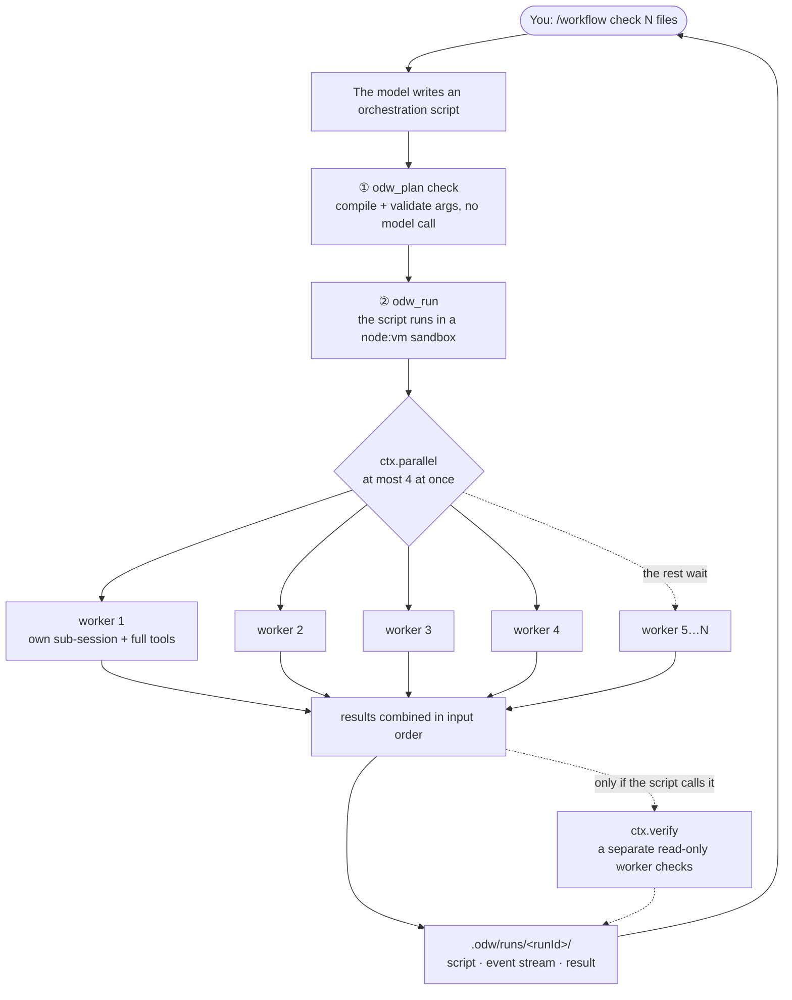

<div align="center">

# opencode-dynamic-workflow (ODW)

**Let opencode send out several sub-agents at once and have them work in parallel.**
The model writes a short orchestration script; the plugin hands the work to several sub-sessions as the script says, then brings the results back to you.

<br>


**English** · [简体中文](README.zh-CN.md)

</div>

## What problem it solves

Three kinds of work are slow and hard to reproduce when you do them turn by turn in one conversation:

| Kind | Example |
|---|---|
| **Do the same thing to N objects** | Check, one by one, whether the comments of 20 files match their implementation |
| **Split up, then combine** | Have 5 agents each look into one module, then merge their findings into one report |
| **Loop until it passes** | Edit code → run tests → edit again if they fail, at most 5 rounds |

ODW's approach: the model writes this kind of task as a **script**, and the plugin runs it. Concurrency, limits, cancellation and a record of everything that happened are the plugin's job; the model only describes *what* to do.

## Highlights

- **The more tasks, the faster**: 16 source-file summaries measured at **24.2 s**, against 39.7 s for a single session - about **1.6x** faster. 4 workers run at once by default, up to 10.
- **Almost no extra resources**: a worker is a session inside the host opencode, not a spawned process. With 8 workers running at once the peak is **417 MB** and **57 threads**, about the same as a single session; 8 separate opencode processes take 1.8-2.4 GB and about 440 threads.
- **No failures under concurrency**: separate opencode processes share one SQLite session database, and 8 of them at once hit `database is locked` and lose tasks. ODW's workers all live in one process; measured **16/16** succeeded.
- **Zero setup**: no API key, no background daemon, zero runtime dependencies. Every model call goes through the opencode you are already logged in to.
- **Every worker is a full sub-session**: its own context and the full tool set, attached under your current session, so you can expand it any time to see what it did.
- **Check first, then run**: `odw_plan` only compiles the script and validates the arguments - no model call, no tokens.
- **It will not run away**: wall time, worker count, primitive steps and spend all have limits; going over raises an error instead of silently truncating results.
- **Results can be double-checked**: `ctx.verify` starts a separate read-only worker whose only job is to find faults; anything it cannot confirm is a fail.
- **Everything is on record**: each run's script, event stream and result are written to `.odw/runs/<runId>/`, and worker sessions are never deleted.
- **A token-saving mode**: for pure question-answering, `mode: "oneshot"` measured at **half** the input tokens of the default mode.

Full data and method: [Performance comparison](#performance-comparison).

## Quick start

**1. Install** (requires opencode v2 and `node` on `PATH`)

```sh
curl -fsSL https://raw.githubusercontent.com/wishflow/opencode-dynamic-workflow/main/scripts/odw-install.sh | sh -s -- --global
```

**2. Restart opencode** (plugins are loaded at startup), then check that it is installed:

```sh
opencode plugin list   # should show: odw  <commit>  github:wishflow/opencode-dynamic-workflow
```

**3. Give it a task in the TUI**

```
/workflow check that every script under workflows/ has header comments matching its implementation
```

The model writes a script, checks it, then runs it. When it finishes you see a summary:

```
ODW run <runId> finished ✅
- workers: <N> started, 0 failed
- elapsed: <seconds>s, cost: $<amount> (<tokens> tok)
- artifacts: <project>/.odw/runs/<runId>
```

You do not have to type `/workflow` every time: when a task suits fan-out, the model loads ODW by itself (see [When does the model use it on its own](#when-does-the-model-use-it-on-its-own)).

## How it works



Key points:

- The script itself **cannot touch the outside world**: it cannot read files, run commands or use the network. Anything that does work is handed to a worker.
- Each `ctx.agent` call creates one sub-session. It hangs under your current session in the session tree, where you can fold it or read it later.
- Tasks beyond the concurrency limit wait in a queue, and results always come back **in input order**, no matter which finishes first.
- A worker uses the same model as your current session by default; the script can give a single worker its own `model`.

## Performance comparison

The same batch of tasks, done three ways, comparing wall time, memory, threads and tokens:

| Approach | What it does |
|---|---|
| **Single session** | One opencode session does every task itself, no ODW |
| **ODW** | One session runs a workflow; `ctx.parallel` hands the tasks to worker sub-sessions |
| **Multi-process** | One separate `opencode run` process per task, with a cap on how many run at once. This is roughly what tools that orchestrate external CLIs do; here it is simulated with `opencode run` directly, no specific project was tested |

### Takeaways

- **Memory and threads barely move.** ODW running 8 workers at once peaks at **417 MB** and **57 threads**, about the same as a single session (377 MB, 56 threads). 8 processes at once take 1.8-2.4 GB and 420-450 threads - **4.2-5.7x** ODW's memory and **7.4-7.9x** its threads.
- **The more tasks, the bigger the win.** 16 summaries: ODW **24.2 s**, single session 39.7 s, about **1.6x** faster. At 8 tasks all three land at 15-18 s, because ODW has a few seconds of fixed overhead: the main session has to start the workflow, and reply once more at the end.
- **Stable under concurrency.** With 8 processes at once, the opencode processes contend for the same SQLite session database, hit `SQLiteError: database is locked`, and some exit 1 (in 4 of 5 rounds, 4-9 processes per round). ODW's workers all live in one process, so this never happens: **16/16** succeeded.
- **More tokens in total, almost all of them cached.** Every worker is a fresh session that carries the system prompt and tool descriptions again, so ODW's total input is 4.5-9x a single session's; **94-97%** of it is a cache hit, and the uncached part is only 19-52% higher. What that costs depends on how your provider prices cache hits.
- **Don't use ODW for work one step can do.** For "read the first line of 8 files", a single session issues all 8 reads in one step and finishes in **7.7 s**; ODW needs 15.2 s and more tokens.

### Data

Each cell is the median of 3 rounds (per column). Input tokens are split into uncached and cache-hit. Bold marks the best value in each column, compared only among approaches that got every answer right.

**Summaries: 8 source files, 5 bullets each, 4 at a time**

| Approach | Wall | Peak RSS | Peak threads | Peak procs | Input uncached | Input cached | Output | Correct |
|---|--:|--:|--:|--:|--:|--:|--:|:--:|
| Single session | **15.0 s** | **400 MB** | **57** | **3** | **10.8k** | **26.5k** | **1.6k** | 8/8 |
| **ODW** | 17.8 s | 411 MB | 58 | 4 | 13.6k | 260.1k | 2.3k | 8/8 |
| Multi-process | 15.6 s | 1416 MB | 224 | 12 | 23.1k | 224.9k | 2.4k | 8/8 |

**Summaries: 16 source files, 8 at a time**

| Approach | Wall | Peak RSS | Peak threads | Peak procs | Input uncached | Input cached | Output | Correct |
|---|--:|--:|--:|--:|--:|--:|--:|:--:|
| Single session | 39.7 s | **377 MB** | **56** | **4** | **25.0k** | **92.5k** | **3.2k** | **16/16** |
| **ODW** | **24.2 s** | 417 MB | 57 | 7 | 29.9k | 493.8k | 4.5k | **16/16** |
| Multi-process | 194.9 s | 1950 MB | 436 | 24 | 27.3k | 290.8k | 3.1k | 10/16 |

In this group the 3 multi-process rounds lost 7, 5 and 4 processes to `database is locked`. Failed tasks produce nothing, hence the lower tokens and the longer wall time. Two extra rounds were run: one lost 9; the other had no failures and took 38.5 s, 2391 MB and 448 threads. So even when nothing fails, it only matches a single session's speed, at **5.7x** ODW's memory.

**First line: 8 tiny files, 4 at a time (fixed overhead)**

| Approach | Wall | Peak RSS | Peak threads | Peak procs | Input uncached | Input cached | Output | Correct |
|---|--:|--:|--:|--:|--:|--:|--:|:--:|
| Single session | **7.7 s** | **383 MB** | **57** | **4** | **5.7k** | **26.4k** | **0.3k** | 8/8 |
| **ODW** | 15.2 s | 403 MB | **57** | 5 | 8.6k | 276.5k | 0.7k | 8/8 |
| Multi-process | 20.5 s | 1397 MB | 223 | 12 | 11.8k | 245.6k | 0.6k | 8/8 |

### Method

- **Environment**: Apple M1 Pro (10 cores), 16 GB RAM, macOS 14.5; opencode 2.1.0; model deepseek-v4.1-flash.
- **Config**: an isolated opencode config holding only the model provider, with no MCP servers and no other plugins; ODW is loaded from this checkout.
- **Procedure**: every approach runs in a freshly created throwaway project each round; one warm-up run before measuring; 3 rounds per group.
- **Memory, threads, processes**: the whole process tree is sampled every 250 ms and the peak kept. Memory is the sum of each process's RSS, which counts pages shared between processes more than once, so the multi-process figures somewhat overstate real usage.
- **Tokens**: read from opencode's own session table for every session the round created, worker sub-sessions included.
- **Correct**: every answer must carry an agreed marker (`== <file path> ==` for summaries, the file's real first line for the first-line task), and the script checks each one.
- **MCP not measured**: in a real setup every opencode process starts its own set of local MCP servers, so the multi-process process count and memory would only go up (not measured).

Run it yourself (pick a model configured in your opencode with `--model provider/model`):

```sh
node tests/bench/bench.mjs --task summary --n 8 --c 4 --rounds 3
node tests/bench/bench.mjs --task summary --n 16 --c 8 --rounds 3
node tests/bench/bench.mjs --task line --n 8 --c 4 --rounds 3
```

## Usage

### `/workflow <task>`: the manual entry point

The command itself runs nothing. It hands the task to the model, which loads the `odw` skill, checks with `odw_plan` first, then runs with `odw_run`. Workers are only ever created in one place: the tool.

> `/workflow` only works in the TUI (or through `session.command`). `opencode run "/workflow x"` does not trigger the command; the whole string is sent as an ordinary prompt. For headless use, call `odw_run` directly.

### When does the model use it on its own

ODW injects nothing into what you type and registers no prompt hook. All it ships is a skill file, `skills/odw/SKILL.md`:

- the skill's `description` says **when to use it**: several concurrent sub-sessions, fan-out, multi-step pipelines, loop-until-it-passes - and not for single-step tasks or pure discussion;
- the skill's body says **how to use it**: plan first, then run.

Whether to use it is the model's call; there is no keyword list. Measured: the same fan-out task, described in English, Japanese and Korean, loaded the skill automatically all three times and ran to completion.

### The three tools

| Tool | Written in Code Mode as | Calls a model? | What it does |
|---|---|:--:|---|
| `odw_plan` | `tools.odw.plan` | no | Compiles the script, validates the arguments against the agents and models currently available, and reports what *would* run |
| `odw_run` | `tools.odw.run` | yes (inside the script only) | Actually runs the script |
| `odw_ping` | `tools.odw.ping` | no | Checks that the plugin is alive |

The two left columns are **the same tool**, written once for a normal call and once for a Code Mode call.

`odw_run` arguments:

```js
{ script: 'async (ctx) => {...}' }   // pass the script source directly
{ file: "audit.ts" }                 // or refer to a file under <project>/workflows/
// optional: runId / concurrency (default 4, max 10) / timeoutMs (default 600000)
//           / budgetUsd / maxWorkers (default 50)
```

### What a script looks like

The model usually writes the script; you only need to look it over before letting it run. A typical "fan out + double-check" script:

```js
async (ctx) => {
  const files = ["src/a.ts", "src/b.ts", "src/c.ts"]

  // one worker per file, at most 3 at once
  const notes = await ctx.parallel(files, (file) =>
    ctx.agent({
      label: "audit:" + file,
      prompt: `Read ${file}, decide whether its header comment matches the implementation, reply with JSON only`,
      schema: {
        type: "object",
        properties: { ok: { type: "boolean" }, why: { type: "string" } },
        required: ["ok", "why"],
      },
    }),
    { concurrency: 3 },
  )

  // then a read-only worker looks for faults; anything it cannot confirm is a fail
  const check = await ctx.verify("Every audit conclusion below matches the source: " + JSON.stringify(notes))

  return { notes, verified: check.pass }
}
```

A fuller example (pipeline + checkpoint + verify) is in [`workflows/audit.ts`](workflows/audit.ts).

### What a script can use

Inside the sandbox there is a single `ctx` object:

| Primitive | What it does |
|---|---|
| `ctx.agent(o)` | Start a sub-session, send a prompt, wait for it to finish and return its text; with a `schema`, return the parsed object |
| `ctx.parallel(items, fn, {concurrency?})` | Apply the same operation to every item in parallel; results come back in input order |
| `ctx.pipeline(items, ...stages)` | Each item passes through several stages in turn, each stage receiving the previous one's output; items run in parallel |
| `ctx.loop({max, body, until?, initial?})` | Iterate; `max` is required; stops early once `until` holds; returns `{iterations, state, stopped}` |
| `ctx.verify(claim \| o)` | Have a read-only worker adversarially check a claim; returns `{pass, reasons}`, and anything it cannot confirm is `pass: false` |
| `ctx.checkpoint(label, data?)` | Record a checkpoint in the event stream and the `checkpoints/` directory |
| `ctx.phase(name)` / `ctx.log(...)` | Report progress, log |
| `ctx.budget()` | See how much has been spent so far |
| `ctx.abort(reason?)` | End this run deliberately |

### `ctx.agent` options

```ts
{
  prompt: string             // required, non-empty
  label?: string             // shown in progress, the event stream and the sub-session title
  agent?: string             // opencode agent id, e.g. "explore" | "build"
  model?: string             // "provider/model" or "provider/model#variant"
  effort?: string            // shorthand for the model's variant; cannot be combined with model
  mode?: "agentic" | "oneshot"   // oneshot = every tool disabled, question-answering only
  permissions?: "inherit" | "read-only" | "dangerous-full-access" | Permission[]
  schema?: object            // JSON Schema; the reply is parsed as JSON
  timeoutMs?: number         // this worker's own timeout
}
```

**`agentic` or `oneshot`?**

| | `agentic` (default) | `oneshot` |
|---|---|---|
| Can use tools | Yes (read files, run commands, ...) | No, answers from the prompt only |
| Measured time (same prompt) | 1.58 s | 1.37 s |
| Measured input tokens | 2116 | 1050 (about half) |
| Good for | Tasks that need to look things up or read code | Summarizing, rewriting, classifying - pure text |

`oneshot` is not a single turn enforced by opencode: ODW denies the session every permission and says in the prompt that no tools are available. The model may still try to call a tool, and will be refused. Measured: asked to read a file, it replied "this session has no file access, please paste the contents", and invented nothing.

### When something fails

**There is no automatic retry.** If any worker fails, the script stops, and the tool hands a structured error (error kind, message, run directory) back to the model, which edits the script and runs it again. If you want retries, write them with `ctx.loop`.

## Limits and budget

| Item | Default | Adjustable? | When exceeded |
|---|---|---|---|
| Total time per run | 10 min | `timeoutMs`, up to 24 h | Fails the run; synchronous infinite loops are interrupted too |
| Workers running at once | **4** | `concurrency`, up to **10** | The rest wait in a queue |
| Workers per run | **50** | `maxWorkers`, up to 10000 | Raises `worker-limit`; never silently truncated |
| Primitive steps | **500** | Fixed | Fails the run; each `agent`/`parallel`/`pipeline`/`loop`/`verify`/`checkpoint`/`log`/`phase` call counts 1 step |
| Spend | Counted, not limited | `budgetUsd` | Once over, no new worker starts; running ones are not interrupted |
| Cancellation | — | — | Stops dispatching and interrupts the running workers (their sessions are kept) |

> **The money limit has only been verified by unit tests.** Free models report `cost = 0` on every call (token counts are normal), so the "stop when over budget" path has no real-money evidence yet. Token counting, the worker cap, the step cap and the concurrency cap are all verified on a real machine.

## Safety boundary

Scripts run in a `node:vm` sandbox that holds only `ctx` and a redirected `console`:

| Not in the sandbox | Which means |
|---|---|
| `require` / `import` / `import()` | Cannot load any module |
| `process` / `fs` / `path` / `os` | No environment variables, no file access, no child processes |
| `fetch` / `XMLHttpRequest` / `WebSocket` | No network |
| `eval` / `new Function` | Disabled (measured: throws `EvalError`) |
| Timers, host globals | Not injected, not reachable |

**Note: this is a guard rail against wrong code, not a security sandbox.**

- `node:vm` is not security isolation; escaping through the `constructor` chain is a known technique, and it is **not** defended against here.
- The correct use is: **the model writes the script → you look it over → the plugin runs it**. Do not use it to run scripts of unknown origin.
- What actually backs you up is the limits above, the structured errors and the full record.
- The capabilities in the table above, and "the `vm` timeout really interrupts an infinite loop", are verified by the contract suite against a real opencode: all pass on opencode 2.1.0 (embedded Bun 1.4.2).

## Run artifacts

Every run leaves a full record under `<project>/.odw/runs/<runId>/`:

```
.odw/runs/<runId>/
├── script.ts          # the script actually executed (after normalization)
├── meta.json          # runId, owning session, directory, origin, limits
├── journal.jsonl      # event stream: run-start, worker-start, step, worker-end, run-end, ...
├── result.json        # machine-readable result: workers, steps, spend, tokens, return value, summary
└── checkpoints/       # files written by ctx.checkpoint (names sanitized against path traversal)
```

- **Only the last 50 runs are kept.** At the end of every run, run directories are sorted by runId and only the last 50 kept. Default runIds carry a timestamp, so that means the 50 most recent.
- **Worker sessions are never deleted.** To see exactly what a worker did, expand it in the session tree.

## Install and manage

### Global install (recommended)

```sh
curl -fsSL https://raw.githubusercontent.com/wishflow/opencode-dynamic-workflow/main/scripts/odw-install.sh | sh -s -- --global
# or, from a local checkout, install from the local files:
./scripts/odw-install.sh install --global
```

The script does two things:

1. Registers the plugin through opencode's own installer: `opencode plugin add github:wishflow/opencode-dynamic-workflow`, which downloads the package right away.
2. Writes the skill to `~/.config/opencode/skills/odw/SKILL.md`.

Then **restart opencode** and check with `opencode plugin list`.

> `opencode plugin add` sometimes fails on its first attempt with a transient npm registry error (measured: 2 of 3 runs, `No matching version found ...` or `Error: aborted`); the script retries once automatically.

### Project-local install

```sh
./scripts/odw-install.sh install --local
```

- opencode's CLI can only edit the global config, so `--local` has the script edit the project's `opencode.json` itself: it appends one entry to `plugins` and leaves everything else alone.
- The skill goes to `<project>/.opencode/skills/odw/SKILL.md`.
- The package is not downloaded up front; opencode installs it in the background on its next start. The first time takes about 2.5 minutes, during which the plugin is not available.
- `opencode plugin list` only shows the global config; for a project-local install, look for `msg="loading plugin" ... entrypoint=...` in the startup log.

### Status, update, rollback

```sh
./scripts/odw-install.sh status    [--global|--local]   # what is installed, and does it still match
./scripts/odw-install.sh update    [--global|--local]   # update the plugin and the skill
./scripts/odw-install.sh rollback  [--global|--local]   # undo the install, restore the previous files
```

| Command | Description |
|---|---|
| `status` | Shows the scope, the config/skill/install-record paths, whether the plugin is registered, whether the skill has been modified; in global mode it also tells you whether the current project has a project-local install |
| `update` | Updates the skill and tries `opencode plugin update`. The latter needs a reachable opencode service; if it fails you only get a warning |
| `rollback` | Restores the files first and the config last. In the other order the config would briefly point at a plugin that does not exist yet, and opencode would log a burst of `failed to load plugin ... ENOENT` |
| `--ref <ref>` | Download from the given branch or tag instead of `main` |

## Similar projects

Three projects with different positioning:

- **ODW**: an opencode plugin; orchestration happens inside the opencode process.
- **[open-dynamic-workflows](https://github.com/Suraj1235/open-dynamic-workflows)**: a standalone engine with its own background process and adapters for many hosts.
- **[open-dynamic-workflow](https://github.com/travisliu/open-dynamic-workflow)**: a local runner that drives external agent CLIs.

The table lists only verifiable facts; anything the other README does not say is marked "not stated".

| | **ODW** (this repo) | **open-dynamic-workflows** | **open-dynamic-workflow** |
|---|---|---|---|
| Form | opencode v2 plugin | Standalone engine + adapters for many hosts | Local runner that drives external agent CLIs |
| Who orchestrates | The model writes a script; the plugin runs it inside the host process | The model writes `execute()`; the background process runs it | Scripts drive external CLIs; it implements no agent itself |
| Models and credentials | Uses opencode's login; no key needed | Bring your own key (`~/.odw/config.json`) or local Ollama | Uses each external CLI's login |
| Background process | None | Needs a local daemon (localhost HTTP/WS) | Not mentioned in its README |
| Sandbox | `node:vm` + allowlist, **explicitly not a security boundary** | QuickJS compiled to WASM isolation | Not stated |
| Resume after a crash | No; worker sessions are kept for inspection | Yes: SQLite + WAL, `--resume` | Not stated |
| Supported hosts | opencode v2 only | OpenCode, Cursor, Codex, Gemini CLI, Kimi, Zed/zcode, Antigravity, VS Code, shell, MCP | The CLIs of Codex, Gemini, Copilot, OpenCode, Antigravity, Pi, Cursor |
| Dependencies and distribution | 0 runtime deps; installed from GitHub, not on npm | 0 runtime deps (12 sub-packages); installed by clone, not on npm | 6 runtime deps; published as `@travisliu/open-dynamic-workflow` |

**Which to pick:**

- You use opencode and want the **lowest cost of adoption** (no key, no service, no dependencies), with every worker viewable in the session tree → **ODW**.
- You need **many hosts**, or crash resume and stronger sandbox isolation → **open-dynamic-workflows**, at the price of bringing your own key and running a background process, with more to configure and more that can go wrong.
- You want to drive the existing agent CLIs, ready with one `npx` → **open-dynamic-workflow**; it ships a mock provider that makes deterministic tests easy, and its ceiling is bounded by how stable each CLI is.

## Known limitations

- **opencode v2 only**, and not published on npm yet.
- **`/workflow` cannot be triggered from `opencode run`**; for headless use, call `odw_run` directly.
- **`odw_plan` only reads literals.** A variable argument such as `agent: someVar`, or a call built inside `parallel` / `loop`, is marked `dynamic` and skipped, so the check cannot tell how many workers will actually start.
- **A passing check is not a passing run.** It sees neither logic errors nor runtime failures.
- **No automatic retry, no crash resume.** After a crash the whole run starts over, but the finished worker sessions are still there to investigate.
- **Free models report no money**, so `budgetUsd` does nothing on free models (see [Limits and budget](#limits-and-budget)).
- **A worker inherits the session's model by default.** If the session runs on a free tier, every worker hits the provider quota and the run fails with `kind: "internal"`. When you drive ODW from `opencode run`, pass `--model` explicitly.
- **The sandbox is not a security boundary** (see [Safety boundary](#safety-boundary)).

## Development

```sh
npx tsc --noEmit                               # type check (no build step)
npx vitest run tests/unit                      # unit tests (84)
ODW_CONTRACT=1 npx vitest run tests/contract   # contract tests (62 assertions, starts a real opencode)
node tests/contract/opencode-v2/run.mjs --keep # keep the test artifacts for debugging
node tests/bench/bench.mjs                     # performance comparison (see "Performance comparison")
```

**The contract tests are not mocks**; they are a behaviour snapshot taken by actually running opencode (see `tests/contract/opencode-v2/CONTRACT.md`). They create a throwaway git project, plant a probe plugin and a skill, start `opencode run`, and check the real results. They never read or write your `~/.config/opencode`.

**The one rule of development: never start opencode inside this repository.** opencode would discover the plugin and reload it on every edit you make. The contract tests already avoid this: they create a throwaway project, start opencode inside it, and set `PWD` explicitly. Setting only `cwd` silently binds the server to the wrong project.

```
src/
├── index.ts                    # plugin entry: Plugin.define({id:"odw", setup})
├── types.ts                    # error types, AgentOptions / RunContext / ScriptHost interfaces
├── plugin/{tools,commands,guard}.ts
├── script/{host,host-vm,normalize,api-doc,plan}.ts
├── primitives/{agent,parallel,pipeline,loop,verify,index}.ts
├── worker/{agentic,result,lifecycle}.ts
├── runner/{runner,semaphore,budget,deadline,steps,journal}.ts
└── params/model.ts · artifacts/store.ts
skills/odw/SKILL.md             # the trigger: when to use ODW, and how
scripts/odw-install.sh          # install / update / status / rollback
tests/unit/ · tests/contract/   # unit tests + contract tests
tests/bench/bench.mjs           # performance comparison: single session / ODW / multi-process
workflows/audit.ts              # an example of the file: form (pipeline + checkpoint + verify)
```

## License

MIT - see [LICENSE](LICENSE).
