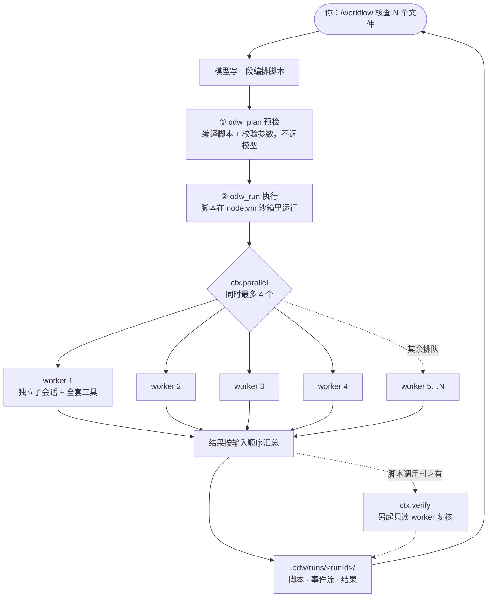

<div align="center">

# opencode-dynamic-workflow (ODW)

**让 opencode 一次派出多个子 agent 并行干活。**
模型写一段编排脚本，插件按脚本把任务分发给多个子会话，跑完把结果汇总给你。

<br>


[English](README.md) · **简体中文**

</div>

## 它解决什么问题

有三类活，放在一个对话里一轮一轮地做，又慢又难复现：

| 类型 | 例子 |
|---|---|
| **对 N 个对象做同一件事** | 逐个检查 20 个文件的注释是否和实现一致 |
| **先分头干，再汇总** | 让 5 个 agent 各查一个模块，最后合成一份报告 |
| **循环到通过为止** | 改代码 → 跑测试 → 没过再改，最多 5 轮 |

ODW 的做法：让模型把这类任务写成一段**脚本**，插件负责执行。并发、上限、取消、记录全过程，都交给插件处理，模型只管描述"要做什么"。

## 亮点

- **真并行，耗时不累加**：默认同时跑 4 个 worker，最多 10 个。实测 2 个 worker 并发总耗时约 2.3 s，和单个 worker 跑一次（约 2.7 s）差不多。
- **零配置接入**：不需要 API key，不需要常驻后台进程，运行时依赖为 0。模型调用全部走你已经登录的 opencode。
- **每个 worker 都是完整的子会话**：有独立上下文和全套工具，挂在你当前会话下面，随时可以展开查看它做了什么。
- **不额外起进程**：worker 是宿主 opencode 里的会话，不 spawn 子进程，也不复制 MCP 连接。
- **先预检，再执行**：`odw_plan` 只编译脚本、校验参数，不调用模型，不花 token。
- **不会跑飞**：总时长、worker 数、调用步数、花费都有上限，超出直接报错，不会悄悄截断结果。
- **结果可复核**：`ctx.verify` 另起一个只读 worker 专门挑刺，确认不了就判为不通过。
- **全程留痕**：每次运行的脚本、事件流和结果都写到 `.odw/runs/<runId>/`，worker 会话也不删除。
- **省 token 模式**：纯问答类任务用 `mode: "oneshot"`，实测 input token 只有默认模式的一半。

## 快速开始

**1. 安装**（需要 opencode v2 和 `PATH` 里的 `node`）

```sh
curl -fsSL https://raw.githubusercontent.com/wishflow/opencode-dynamic-workflow/main/scripts/odw-install.sh | sh -s -- --global
```

**2. 重启 opencode**（插件在启动时加载），确认装上了：

```sh
opencode plugin list   # 应出现：odw  <commit>  github:wishflow/opencode-dynamic-workflow
```

**3. 在 TUI 里下任务**

```
/workflow 核查 workflows/ 下每个脚本的头部注释是否与实现一致
```

模型会先写脚本、预检，然后执行。跑完你会看到一段摘要：

```
ODW run <runId> finished ✅
- workers: <N> started, 0 failed
- elapsed: <秒数>s, cost: $<金额> (<token 数> tok)
- artifacts: <项目>/.odw/runs/<runId>
```

不用每次都敲 `/workflow`：遇到适合扇出的任务，模型会自己加载 ODW（见[模型什么时候会自动用它](#模型什么时候会自动用它)）。

## 工作原理



几个要点：

- 脚本本身**碰不到外部**：不能读文件、不能跑命令、不能联网。凡是要做事，都交给 worker 去做。
- 每调用一次 `ctx.agent`，就创建一个子会话。它在会话树里挂在你的当前会话下面，可以折叠，也可以事后翻看。
- 超出并发上限的任务会排队，结果始终**按输入顺序**返回，和谁先跑完无关。
- worker 默认使用和你当前会话相同的模型，脚本也可以给单个 worker 指定 `model`。

## 用法

### `/workflow <任务>`：手动入口

这个命令本身不执行任何东西。它把任务交给模型，模型再加载 `odw` skill，先 `odw_plan` 预检，再 `odw_run` 执行。所有 worker 都只从工具这一个地方创建。

> `/workflow` 只能在 TUI 里用（或通过 `session.command` 调用）。`opencode run "/workflow x"` 不会触发命令，整串会被当作普通提问发出去。无头场景请直接调 `odw_run`。

### 模型什么时候会自动用它

ODW 不往你的输入里注入任何东西，也不注册 prompt hook。它只提供一个 skill 文件 `skills/odw/SKILL.md`：

- skill 的 `description` 写**什么时候该用**：多个并发子会话、扇出、多步流水线、循环到通过。单步任务和纯讨论不用。
- skill 的正文写**该怎么用**：先 plan，再 run。

要不要用由模型自己判断，没有关键词表。实测把同一个扇出任务分别用英文、日文、韩文描述，三次模型都自动加载了 skill，并成功跑完。

### 三个工具

| 工具 | 在 Code Mode 中的写法 | 调模型？ | 作用 |
|---|---|:--:|---|
| `odw_plan` | `tools.odw.plan` | 否 | 编译脚本，按当前可用的 agent/模型清单校验参数，报告"将要跑什么" |
| `odw_run` | `tools.odw.run` | 是（仅脚本内） | 真正执行脚本 |
| `odw_ping` | `tools.odw.ping` | 否 | 检查插件是否在线 |

左右两列是**同一个工具**，只是普通调用和 Code Mode 调用的写法不同。

`odw_run` 的参数：

```js
{ script: 'async (ctx) => {...}' }   // 直接传脚本源码
{ file: "audit.ts" }                 // 或者引用 <项目>/workflows/ 下的文件
// 可选：runId / concurrency（默认 4，最大 10）/ timeoutMs（默认 600000）
//      / budgetUsd / maxWorkers（默认 50）
```

### 脚本长什么样

脚本通常由模型来写，你只需要看一眼再放行。一个典型的"扇出 + 复核"脚本：

```js
async (ctx) => {
  const files = ["src/a.ts", "src/b.ts", "src/c.ts"]

  // 每个文件交给一个 worker，同时最多 3 个
  const notes = await ctx.parallel(files, (file) =>
    ctx.agent({
      label: "audit:" + file,
      prompt: `读 ${file}，判断头部注释是否与实现一致，只回复 JSON`,
      schema: {
        type: "object",
        properties: { ok: { type: "boolean" }, why: { type: "string" } },
        required: ["ok", "why"],
      },
    }),
    { concurrency: 3 },
  )

  // 再起一个只读 worker 挑刺，确认不了就判不通过
  const check = await ctx.verify("下面的审计结论都与源码相符：" + JSON.stringify(notes))

  return { notes, verified: check.pass }
}
```

更完整的示例（流水线 + 检查点 + 复核）见 [`workflows/audit.ts`](workflows/audit.ts)。

### 脚本里能用什么

沙箱里只有一个 `ctx` 对象：

| 原语 | 作用 |
|---|---|
| `ctx.agent(o)` | 起一个子会话，发送 prompt，等它结束后返回文本；传了 `schema` 就返回解析好的对象 |
| `ctx.parallel(items, fn, {concurrency?})` | 把同一个操作并行作用到每个元素上，结果按输入顺序返回 |
| `ctx.pipeline(items, ...stages)` | 每个元素依次经过多道工序，上一道的输出是下一道的输入；元素之间并行 |
| `ctx.loop({max, body, until?, initial?})` | 循环执行，`max` 必填；`until` 满足就提前停；返回 `{iterations, state, stopped}` |
| `ctx.verify(claim \| o)` | 让一个只读 worker 对结论做对抗性复核，返回 `{pass, reasons}`，确认不了即 `pass: false` |
| `ctx.checkpoint(label, data?)` | 记一个检查点，写入事件流和 `checkpoints/` 目录 |
| `ctx.phase(name)` / `ctx.log(...)` | 报告进度、打日志 |
| `ctx.budget()` | 查看目前花了多少 |
| `ctx.abort(reason?)` | 主动终止本次运行 |

### `ctx.agent` 的选项

```ts
{
  prompt: string             // 必填，不能为空
  label?: string             // 显示在进度、事件流和子会话标题里
  agent?: string             // opencode 的 agent id，如 "explore" | "build"
  model?: string             // "provider/model" 或 "provider/model#variant"
  effort?: string            // 指定模型 variant 的简写；不能和 model 同时给
  mode?: "agentic" | "oneshot"   // oneshot = 禁用全部工具，只做问答
  permissions?: "inherit" | "read-only" | "dangerous-full-access" | Permission[]
  schema?: object            // JSON Schema；回复按 JSON 解析
  timeoutMs?: number         // 这个 worker 自己的超时
}
```

**`agentic` 和 `oneshot` 怎么选**

| | `agentic`（默认） | `oneshot` |
|---|---|---|
| 能用工具 | 能（读文件、跑命令等） | 不能，只能根据 prompt 回答 |
| 实测耗时（同一 prompt） | 1.58 s | 1.37 s |
| 实测 input token | 2116 | 1050（约少一半） |
| 适合 | 需要查资料、看代码的任务 | 总结、改写、分类等纯文本任务 |

`oneshot` 并不是由 opencode 强制的单轮对话：ODW 会拒绝这个会话的全部权限，并在 prompt 里说明没有工具可用。模型仍然可能尝试调工具，但会被拒。实测让它读一个文件，它回答"本会话没有文件访问权限，请把内容贴给我"，没有编造内容。

### 失败了怎么办

**没有自动重试。** 任何一个 worker 失败，脚本就中止，工具把结构化错误（错误类型、信息、运行目录）交回给模型，由模型修改脚本后重跑。需要重试逻辑的话，用 `ctx.loop` 写出来。

## 性能与上限

### 实测数据

| 场景 | 结果 |
|---|---|
| 单个 worker 跑一次（免费模型，极短任务） | 约 2.7 s |
| 2 个 worker 并发 | 总计约 2.3 s，不是两者相加 |
| `oneshot` 与 `agentic` 对比（同一 prompt） | 1.37 s / 1050 input token 对比 1.58 s / 2116 input token |
| `odw_plan` 预检 | 不调用模型，0 token |

### 上限一览

| 项目 | 默认 | 能否调整 | 超出时 |
|---|---|---|---|
| 单次运行总时长 | 10 分钟 | `timeoutMs`，最长 24 小时 | 报错中止；同步死循环也会被打断 |
| 同时运行的 worker | **4** | `concurrency`，最大 **10** | 多出的排队等待 |
| 一次运行的 worker 总数 | **50** | `maxWorkers`，最大 10000 | 报 `worker-limit` 错误，不悄悄截断 |
| 原语调用步数 | **500** | 固定 | 报错中止；`agent`/`parallel`/`pipeline`/`loop`/`verify`/`checkpoint`/`log`/`phase` 每次各计 1 步 |
| 花费 | 只统计，不限制 | `budgetUsd` | 超出后不再启动新 worker，正在跑的不中断 |
| 取消 | — | — | 停止派发，并中断正在跑的 worker（会话保留） |

> **金额限制目前只在单测中验证过。** 免费模型每次调用都报告 `cost = 0`（token 数正常），所以"超预算就停"这条路径还没有真机上的金额证据。token 统计、worker 总数、步数和并发上限都已在真机上验证。

## 安全边界

脚本在 `node:vm` 沙箱里运行，里面只放了 `ctx` 和一个重定向过的 `console`：

| 沙箱里没有 | 意味着 |
|---|---|
| `require` / `import` / `import()` | 不能加载任何模块 |
| `process` / `fs` / `path` / `os` | 读不到环境变量，碰不到文件，起不了子进程 |
| `fetch` / `XMLHttpRequest` / `WebSocket` | 不能联网 |
| `eval` / `new Function` | 被禁用（实测会抛 `EvalError`） |
| 定时器、宿主全局对象 | 没有注入，拿不到 |

**注意：这是防止写错代码的护栏，不是安全沙箱。**

- `node:vm` 本身不是安全隔离，通过 `constructor` 链逃逸是已知手法，这里**不防**。
- 正确用法是：**模型写脚本 → 你过目 → 插件执行**。不要拿它跑来路不明的脚本。
- 真正兜底的是上面的各项上限、结构化错误和全程记录。
- 上表这些能力，以及"`vm` 超时能真正打断死循环"，都由契约测试在真实 opencode 上验证：opencode 2.1.0（内嵌 Bun 1.4.2）上全部通过。

## 运行产物

每次运行都会在 `<项目>/.odw/runs/<runId>/` 下留下完整记录：

```
.odw/runs/<runId>/
├── script.ts          # 实际执行的脚本（归一化之后）
├── meta.json          # runId、所属会话、目录、来源、各项上限
├── journal.jsonl      # 事件流：run-start、worker-start、step、worker-end、run-end…
├── result.json        # 机器可读的结果：worker 数、步数、花费、token、返回值、摘要
└── checkpoints/       # ctx.checkpoint 写的文件（名字已过滤，防止目录穿越）
```

- **只保留最近 50 次运行。** 每次运行结束时，按 runId 排序只留最后 50 个目录。默认 runId 带时间戳，所以就是最近 50 次。
- **worker 会话不会被删除。** 想知道某个 worker 具体做了什么，直接在会话树里展开它。

## 安装与运维

### 全局安装（推荐）

```sh
curl -fsSL https://raw.githubusercontent.com/wishflow/opencode-dynamic-workflow/main/scripts/odw-install.sh | sh -s -- --global
# 或者在本地检出里，用本地文件安装：
./scripts/odw-install.sh install --global
```

脚本做两件事：

1. 通过 opencode 自带的安装器注册插件：`opencode plugin add github:wishflow/opencode-dynamic-workflow`，包会立刻下载。
2. 把 skill 写到 `~/.config/opencode/skills/odw/SKILL.md`。

装完**重启 opencode**，然后用 `opencode plugin list` 确认。

> `opencode plugin add` 偶尔会因 npm registry 的临时错误首次失败（实测 3 次里有 2 次，报 `No matching version found ...` 或 `Error: aborted`），脚本会自动重试一次。

### 项目级安装

```sh
./scripts/odw-install.sh install --local
```

- opencode 的 CLI 只能改全局配置，所以 `--local` 由脚本直接改项目的 `opencode.json`：只往 `plugins` 里追加一项，不动其它配置。
- skill 写到 `<项目>/.opencode/skills/odw/SKILL.md`。
- 不预先下载包，opencode 下次启动时在后台安装。第一次大约要 2.5 分钟，这期间插件不可用。
- `opencode plugin list` 只显示全局配置，项目级安装要看启动日志里有没有 `msg="loading plugin" ... entrypoint=...`。

### 查看、更新、回滚

```sh
./scripts/odw-install.sh status    [--global|--local]   # 装了什么，是否还和安装时一致
./scripts/odw-install.sh update    [--global|--local]   # 更新插件和 skill
./scripts/odw-install.sh rollback  [--global|--local]   # 撤销安装，恢复安装前的文件
```

| 命令 | 说明 |
|---|---|
| `status` | 显示安装范围、配置/skill/安装记录的路径、插件是否已注册、skill 是否被改动过；全局模式下还会提示当前项目有没有项目级安装 |
| `update` | 更新 skill，并尝试执行 `opencode plugin update`。后者需要能连上 opencode 服务，失败只给警告 |
| `rollback` | 先恢复文件，最后恢复配置。顺序反过来的话，配置会短暂指向一个还不存在的插件，opencode 会刷出一串 `failed to load plugin ... ENOENT` |
| `--ref <ref>` | 从指定分支或标签下载，而不是 `main` |

## 与同类项目对比

三个项目定位不同：

- **ODW**：opencode 插件，编排在 opencode 进程内完成。
- **[open-dynamic-workflows](https://github.com/Suraj1235/open-dynamic-workflows)**：独立引擎，自带后台进程，适配多种宿主。
- **[open-dynamic-workflow](https://github.com/travisliu/open-dynamic-workflow)**：本地 runner，调度外部 agent CLI。

下表只列可以核实的事实，对方 README 没写的标为"未声明"。

| | **ODW**（本仓库） | **open-dynamic-workflows** | **open-dynamic-workflow** |
|---|---|---|---|
| 形态 | opencode v2 插件 | 独立引擎 + 多种宿主适配器 | 调度外部 agent CLI 的本地 runner |
| 谁来编排 | 模型写脚本，插件在宿主进程内执行 | 模型写 `execute()`，后台进程执行 | 脚本驱动外部 CLI，自己不实现 agent |
| 模型与凭据 | 用 opencode 的登录态，无需 key | 自带 key（`~/.odw/config.json`）或本地 Ollama | 用各个外部 CLI 的登录态 |
| 后台常驻进程 | 无 | 需要本地 daemon（localhost HTTP/WS） | README 未提及 |
| 沙箱 | `node:vm` + 白名单，**明确说明不是安全边界** | QuickJS 编译到 WASM 隔离 | 未声明 |
| 崩溃后续跑 | 不支持；worker 会话保留可查 | 支持：SQLite + WAL、`--resume` | 未声明 |
| 支持的宿主 | 仅 opencode v2 | OpenCode、Cursor、Codex、Gemini CLI、Kimi、Zed/zcode、Antigravity、VS Code、shell、MCP | Codex、Gemini、Copilot、OpenCode、Antigravity、Pi、Cursor 的 CLI |
| 依赖与分发 | 运行时依赖 0；从 GitHub 安装，未发布 npm | 运行时依赖 0（12 个子包）；clone 安装，未发布 npm | 运行时依赖 6；已发布 `@travisliu/open-dynamic-workflow` |

**怎么选：**

- 你在用 opencode，想要**最低接入成本**（不配 key、不起服务、不装依赖），并希望每个 worker 都能在会话树里查看 → **ODW**。
- 你需要**覆盖多种宿主**，或者需要崩溃续跑、更强的沙箱隔离 → **open-dynamic-workflows**，代价是自备 key、常驻后台进程，配置项和可能出问题的地方更多。
- 你想调度现成的各家 agent CLI，`npx` 一下就用 → **open-dynamic-workflow**，它自带 mock provider，方便做确定性测试；能力上限受各个 CLI 的稳定性约束。

## 已知限制

- **只支持 opencode v2**，还没有发布到 npm。
- **不能从 `opencode run` 触发 `/workflow`**，无头场景请直接调 `odw_run`。
- **`odw_plan` 只看字面量。** 像 `agent: someVar` 这样的变量参数，或在 `parallel` / `loop` 里拼出来的调用，会被标成 `dynamic` 并跳过校验，所以预检阶段算不出实际会起多少个 worker。
- **预检通过不等于运行成功。** 逻辑错误、运行期失败它都看不到。
- **没有自动重试，也不能崩溃续跑。** 崩溃后要整体重跑，但已完成的 worker 会话还在，可以用来排查。
- **免费模型给不出金额**，所以 `budgetUsd` 在免费模型上不起作用（见[性能与上限](#性能与上限)）。
- **worker 默认继承会话的模型。** 如果会话跑在免费档上，所有 worker 都会撞上 provider 配额，运行以 `kind: "internal"` 失败。用 `opencode run` 驱动 ODW 时，请显式传 `--model`。
- **沙箱不是安全边界**（见[安全边界](#安全边界)）。

## 开发

```sh
npx tsc --noEmit                               # 类型检查（无需构建）
npx vitest run tests/unit                      # 单元测试（84 条）
ODW_CONTRACT=1 npx vitest run tests/contract   # 契约测试（62 条断言，会真的启动 opencode）
node tests/contract/opencode-v2/run.mjs --keep # 保留测试现场，方便排查
```

**契约测试不是 mock**，是真的跑 opencode 得到的行为快照（见 `tests/contract/opencode-v2/CONTRACT.md`）。它会建一个临时 git 项目，放入探针插件和 skill，启动 `opencode run`，然后检查实际结果。它不会读写你的 `~/.config/opencode`。

**开发时唯一的铁律：不要在本仓库目录里启动 opencode。** 否则 opencode 会自动发现这个插件，你每改一行它就重新加载一次。契约测试已经避开了这个问题：先建临时项目，再在里面启动 opencode，并显式设置 `PWD`。只设 `cwd` 的话，server 会悄悄绑定到错误的项目上。

```
src/
├── index.ts                    # 插件入口：Plugin.define({id:"odw", setup})
├── types.ts                    # 错误类型、AgentOptions / RunContext / ScriptHost 接口
├── plugin/{tools,commands,guard}.ts
├── script/{host,host-vm,normalize,api-doc,plan}.ts
├── primitives/{agent,parallel,pipeline,loop,verify,index}.ts
├── worker/{agentic,result,lifecycle}.ts
├── runner/{runner,semaphore,budget,deadline,steps,journal}.ts
└── params/model.ts · artifacts/store.ts
skills/odw/SKILL.md             # 触发入口：什么时候用 ODW、怎么用
scripts/odw-install.sh          # install / update / status / rollback
tests/unit/ · tests/contract/   # 单元测试 + 契约测试
workflows/audit.ts              # file: 方式的示例（pipeline + checkpoint + verify）
```

## 许可

MIT，见 [LICENSE](LICENSE)。
