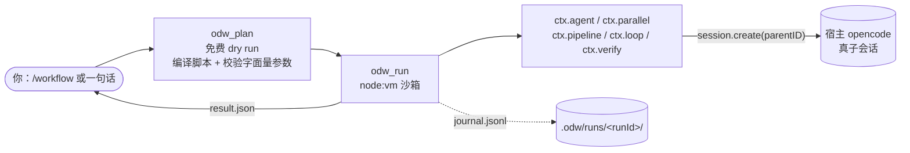

<div align="center">

# opencode-dynamic-workflow (ODW)

**把动态工作流做进 opencode v2 的一等公民**：模型写一个受约束的脚本，插件确定性地执行它，每个 worker 都是宿主 opencode 的一个真子会话。

[**快速开始**](#快速开始)&nbsp;·&nbsp;[**它是什么**](#它是什么)&nbsp;·&nbsp;[**工作原理**](#工作原理)&nbsp;·&nbsp;[**写一个脚本**](#写一个脚本)&nbsp;·&nbsp;[**边界与预算**](#边界与预算)&nbsp;·&nbsp;[**为什么选择 ODW**](#为什么选择-odw)&nbsp;·&nbsp;[**已知限制**](#已知限制)

<br>


[English](README.md)&nbsp;·&nbsp;**简体中文**

</div>

```
/workflow 核查 workflows/ 下每个脚本的头部注释是否与实现一致
   │
   ├─ odw_plan   免费 dry run：编译脚本 + 按活体清单校验字面量参数
   ├─ odw_run    真执行：node:vm 沙箱，每个 ctx.agent 起一个真子会话
   └─ 产物       .odw/runs/<runId>/：result.json · journal.jsonl
```

## 它是什么

ODW 面向三类任务：对 N 个对象重复同一操作、先扇出再汇总、循环执行直至通过。这类任务在单个会话中逐轮完成时，速度慢、强制串行、不可复现；写成脚本后，并发、预算、取消与执行记录统一由插件承担。**ODW 不需要 API key**：所有模型调用都发生在宿主 opencode 的子会话中，使用你已有的登录态与 provider 凭据。

| 脚本即编排器 | 执行永远显式 | 全程留痕 |
| :--: | :--: | :--: |
| 模型写一次脚本，插件确定性地执行 | 只有 `/workflow` 与 `odw_run` 会创建 worker | 每次运行落盘：脚本、事件流、结果、检查点 |

## 快速开始

前置条件：opencode v2（通过内嵌 Bun 直接加载 TypeScript），以及 `PATH` 中的 `node`。ODW 的运行时依赖为 0。

```sh
# 全局安装（推荐）
curl -fsSL https://raw.githubusercontent.com/wishflow/opencode-dynamic-workflow/main/scripts/odw-install.sh | sh -s -- --global

# 或：在本地检出中执行同一步（用本地文件，不下载）
./scripts/odw-install.sh install --global
```

插件经由 opencode 自身的安装器写入配置（`opencode plugin add github:wishflow/opencode-dynamic-workflow`），因此配置形式与 opencode 的约定一致，包也会被预先拉取。

<details><summary><b>安装脚本的动作与顺序</b></summary>

| # | 动作 | 为什么在这个位置 |
|---|---|---|
| 0 | 写清单 `~/.config/opencode/.odw-migration.json` | 先于任何改动；中途失败仍可 `rollback` |
| 1 | 备份 `opencode.json` → `opencode.json.bak.<ts>` | 回滚需要逐字节精确的旧内容 |
| 2 | 清理遗留安装：删去 deprecated 的 `plugin` 键，把 `plugins/odw.mjs`、`commands/{odw,ultracode,workflows}.md` 改名为 `*.disabled` | 只改名、不删除；先改配置，再让文件失去引用 |
| 3 | `opencode plugin add <spec>`（自动重试一次） | 它自行修改配置；重试有实测依据，见下 |
| 4 | 写 skill `~/.config/opencode/skills/odw/SKILL.md` | 最后写入，执行器就位后触发面才出现 |

</details>

随后**重启 opencode**（配置与插件在 server 启动时读取），并核对 `opencode plugin list` 中出现 `odw  <commit>  github:wishflow/opencode-dynamic-workflow`。

<details><summary><b>第 3 步重试的实测依据</b></summary>

观察到的 3 次中，`opencode plugin add` 有 2 次首跑失败，报瞬时 registry 错误（`No matching version found for @redis/json@6.3.1`、`Error: aborted`），紧接着重试即成功。该重试不是防御性噪声。

</details>

<details><summary><b>只装在某个项目里（--local）</b></summary>

opencode 的 CLI 只修改**全局**配置，因此 `--local` 由脚本自行写入项目的 `opencode.json`（合并进 `plugins`，不覆盖其它键），skill 落在 `<项目>/.opencode/skills/odw/SKILL.md`；配置形如 `{ "plugins": ["github:wishflow/opencode-dynamic-workflow"] }`（连同 `$schema`）。它**不预取包**：opencode 下次启动时在后台安装，首次约 2.5 分钟，期间插件不可用。`opencode plugin list` 只反映全局配置，项目级安装需以启动日志验证（`msg="loading plugin" ... entrypoint=...`）。

</details>

## 运维

```sh
./scripts/odw-install.sh status    [--global|--local]   # 装了什么、是否仍然一致
./scripts/odw-install.sh update    [--global|--local]   # 刷新插件与 skill
./scripts/odw-install.sh rollback  [--global|--local]   # 撤销，恢复到此前的字节
```

- **status** 报告作用域、配置/skill/清单路径、插件 spec 是否在册、skill 是否仍与安装时记录的摘要一致、是否残留旧安装；不带 `--local` 时还报告当前项目是否存在本地安装。
- **update** 刷新 skill，并尽力执行一次 `opencode plugin update`（该命令需要可连通的 opencode 服务；失败只给警告，不视为更新失败）。
- **rollback** 的顺序是**先恢复文件、最后恢复配置**。该顺序是刻意的：先恢复配置会形成「配置指向一个尚不存在的插件文件」的窗口，opencode 的插件注册表 reconcile 撞上后会刷出一串 `failed to load plugin ... ENOENT`。`--ref <ref>` 把下载固定到指定分支或标签，而非 `main`。

## 工作原理



**触发面是一个 skill 文件，而不是向 prompt 注入内容。** 仓库自带 `skills/odw/SKILL.md`，安装器把它复制到 opencode 发现 skill 的位置（全局 `~/.config/opencode/skills/odw/SKILL.md`，项目级 `<项目>/.opencode/skills/odw/SKILL.md`）。opencode 把 `description` 提供给模型，模型在任务匹配时加载正文。

<details><summary><b>触发机制的设计后果</b></summary>

```md
description: 把任务扇出给多个并发子会话（fan-out / 并行子 agent / 多步流水线 / 循环到通过）并汇总产物；单步任务、或仅在讨论机制时不用。
```

- 插件**不注册任何 prompt hook**，不改写你输入的内容：模型看到的是你发送的内容，加上 opencode 提供的 skill 清单。
- 不会自动执行：skill 的终点是调用 `odw_plan` / `odw_run`，二者都是普通工具，仅在模型或用户调用时生效。
- **何时**使用 ODW 写在 `description`，**如何**驱动写在正文，两者同处一个文件，可像源码一样 review。
- 机制中**没有关键词表**，判断完全交给模型。2026-10-29 实测：同一个扇出型任务以英文、日文、韩文分别叙述，三次均自动加载 skill 并产出真实结果（`status: "ok"`）。

</details>

## 写一个脚本

`/workflow <任务>` 是人工入口，它自身不执行任何操作：任务交给模型，由模型加载 `odw` skill、先 `odw_plan`（免费 dry run）、再 `odw_run`。执行的代码路径只有一条——工具——因此创建 worker 的位置也只有一处。

| 工具 | Code Mode 路径 | 调用模型 | 作用 |
|---|---|:--:|---|
| plan | `tools.odw.plan` | **否** | 编译脚本 + 按活体清单校验字面量参数，报告将要执行的内容 |
| run | `tools.odw.run` | 是（仅脚本内） | 真正执行脚本 |
| ping | `tools.odw.ping` | 否 | 存活自检 |

```js
// tools.odw.run
{ script: 'async (ctx) => {...}' }   // 内联源码
{ file: "audit.ts" }                 // 相对 <项目>/workflows/ 解析
// 可选：runId / concurrency（默认 4，上限 10）/ timeoutMs（默认 600000）
//       / budgetUsd / maxWorkers（默认 50）
```

沙箱中**有且只有** `ctx`：

| 原语 | 作用 |
|---|---|
| `ctx.agent(o)` | 起一个真子会话，发 prompt，等它结束，返回文本（给了 `schema` 则返回解析后的对象） |
| `ctx.parallel(items, fn, {concurrency?})` | 有界并发扇出，结果**按输入顺序**返回 |
| `ctx.pipeline(items, ...stages)` | `parallel` 加每个 item 顺序通过的一条 stage 链，stage 收到上一级的返回值 |
| `ctx.loop({max, body, until?, initial?})` | 迭代；`max` 必填，`until` 成立即停；返回 `{iterations, state, stopped}` |
| `ctx.verify(claim \| o)` | 只读 worker 做**对抗性复核**，返回 `{pass, reasons}`，无法确认即 `pass: false` |
| `ctx.checkpoint(label, data?)` | 落一个持久标记（journal 与 `checkpoints/` 下的文件） |
| `ctx.abort(reason?)` | 主动终止本次运行 |
| `ctx.phase(name)` / `ctx.log(...)` | 进度与日志 |
| `ctx.budget()` | 目前的花费 |

<details><summary><b>ctx.agent 的完整选项</b></summary>

```ts
{
  prompt: string             // 必填、非空
  label?: string             // 进度、journal、子会话标题里用
  agent?: string             // opencode agent id，如 "explore" | "build"
  model?: string             // "provider/model" 或 "provider/model#variant"
  effort?: string            // 模型 #variant 的语法糖；不能与 model 同时给
  mode?: "agentic" | "oneshot"   // oneshot = 拒绝全部工具
  permissions?: "inherit" | "read-only" | "dangerous-full-access" | Permission[]
  schema?: object            // JSON Schema；回复按 JSON 解析
  timeoutMs?: number         // 单个 worker 的墙钟
}
```

</details>

**没有自动重试。** worker 失败即抛错并中止脚本；工具把结构化错误（`kind` + `message` + 现场目录）交回模型，由模型修改脚本后重跑。需要重试时以 `ctx.loop` 自行表达。

## 边界与预算

脚本运行在 `node:vm` 中，注入的白名单**只有** `ctx` 与被重定向的 `console`。

| 沙箱中**没有** | 因此 |
|---|---|
| `require` / `import` / 动态 `import()` | 脚本无法加载任何模块 |
| `process` / `fs` / `path` / `os` | 无法读环境变量、无法访问文件、无法起子进程 |
| `fetch` / `XMLHttpRequest` / `WebSocket` | 没有网络 |
| `eval` / `new Function` | 被 `codeGeneration:{strings:false}` 阻断（实测抛 `EvalError`） |
| 定时器 / 宿主全局对象 | 未注入，不可达 |

| 上限 | 默认 | 说明 |
|---|---|---|
| 单脚本墙钟 | 10 min | 每次原语调用前检查；同步死循环由 vm `timeout` 打断 |
| 并发 | **4**（上限 10） | 脚本的 `concurrency` 只能向下收，不能越过它 |
| 总 worker 数 | **50** | 超出抛 `worker-limit`，**不静默截断** |
| 原语调用步数 | **500** | 每次 `agent`/`parallel`/`pipeline`/`loop`/`verify`/`checkpoint`/`log`/`phase` 记 1 步；防的是「不花钱但失控」 |
| 预算 | 默认只统计 | 给了 `budgetUsd` 就**事后**判定：worker 一完成即累加，超出后停止派发（不杀正在跑的） |
| 取消 | `context.signal` | 触发后：停派发 → `interrupt` → `remove` |

<details><summary><b>能力围栏不是安全边界</b></summary>

这一档的威胁模型是「模型写错代码」，不是「攻击者拿到任意代码执行」：`node:vm` 不是安全沙箱，`constructor` 链逃逸是已知的、本档**不防**的手法；正确用法是**脚本由模型写、由用户过目、由插件执行**，而不是执行来路不明的脚本；防「写错」的主力不是隔离，而是上限治理（上表）、结构化错误与逐步留痕；若将来需要真隔离，接口已预留升级到 `worker_threads` 宿主（可 `terminate()`）。

能力门在**启动时判定**：`vm` 必须支持 `runInContext({timeout})` 且能真正打断纯 CPU 死循环，否则这一档不成立。opencode 2.1.0（内嵌 Bun 1.4.2）实测四项全过。

</details>

<details><summary><b>预算语义的实测边界</b></summary>

`budgetUsd` 的**金额**语义在免费模型上无法验证：`compass/deepseek-v4.1-flash` 每次调用都上报 `cost = 0`（token 数非 0）。因此「超预算即停止派发」这条链路只有单测覆盖，没有真机金额证据；token 计数、`maxWorkers`、`maxSteps` 与并发上限均有真机证据。

</details>

<details><summary><b>mode: "oneshot" 的实际语义</b></summary>

- 它**不是**宿主强制的单轮：opencode 的 `session.create` 没有「禁用工具」开关（已核对 generated types），ODW 的做法是拒绝全部权限（`[{action:"*",resource:"*",effect:"deny"}]`，实测确实落到会话行上），并在 prompt 中说明没有工具。
- 模型仍可**尝试**调用工具，调用会被拒绝，随后只能用 prompt 中已有的信息作答。实测：要求它读取一个文件时，它回答「本会话没有文件访问，请把内容贴给我」，**没有编造**内容。
- 若答案依赖外部信息，`oneshot` 是错误选择，应使用默认的 `agentic`。同一 prompt 的实测：`oneshot` 1.37s / 1050 input tokens，`agentic` 1.58s / 2116 input tokens（agentic 多出工具描述开销）。

</details>

## 运行产物

每次运行落一盘证据到 `<项目>/.odw/runs/<runId>/`：

```
.odw/runs/<runId>/
├── script.ts          # 实际执行的脚本源码（归一化之后）
├── meta.json          # runId / sessionID / directory / origin / 上限 / scriptHost
├── journal.jsonl      # 追加式事件流（run-start、worker-start、step、worker-end、run-end…）
├── result.json        # 机器可读结果：workers/steps/cost/tokens/returnValue/humanSummary…
└── checkpoints/       # ctx.checkpoint 落的文件（label 会消毒，防目录穿越）
```

**worker 会话不会被删。** 它们的 transcript 是「发生了什么」的一手证据，`parentID` 让它们在你的会话树里可折叠。

## 为什么选择 ODW

三者定位不同：ODW 把编排做进 opencode 插件进程内；[open-dynamic-workflows](https://github.com/Suraj1235/open-dynamic-workflows) 是自带 daemon 与多宿主适配器的独立引擎；[open-dynamic-workflow](https://github.com/travisliu/open-dynamic-workflow) 是编排外部 agent CLI 的本地 runner。下表只列可核实事实，对方 README 未声明处一律标注。

| | **ODW**（本仓库） | **open-dynamic-workflows** | **open-dynamic-workflow** |
|---|---|---|---|
| 定位 | opencode v2 插件 | 独立引擎，配套多种宿主适配器 | 编排外部 agent CLI 的本地 runner |
| 编排者 | 模型写脚本，插件在宿主进程内执行 | 模型写 `execute()`，由 daemon 执行 | 脚本驱动外部 CLI；自身不实现 agent |
| 模型与凭据 | 复用宿主 opencode 的登录态，无需 key | 自带 key（`~/.odw/config.json`）或本地 Ollama | 复用各外部 CLI 的登录态 |
| 常驻进程 | 无 | 需要本地 daemon（localhost HTTP/WS） | README 未提及常驻服务 |
| 沙箱 | `node:vm` + 白名单注入，**明示不是安全边界** | QuickJS 编译到 WASM 隔离 | README 未声明 |
| 崩溃续跑 | 无；worker 会话保留作证据 | 有：SQLite + WAL、`--resume` | README 未声明 |
| 宿主覆盖 | 仅 opencode v2 | OpenCode、Cursor、Codex、Gemini CLI、Kimi、Zed/zcode、Antigravity、VS Code、shell、MCP | Codex、Gemini、Copilot、OpenCode、Antigravity、Pi、Cursor 的 CLI |
| 依赖与分发 | 运行时依赖 0；未发布 npm，从 GitHub 安装 | 运行时依赖 0（12 个子包）；未发布 npm，clone 安装 | 运行时依赖 6；已发布 `@travisliu/open-dynamic-workflow` |

**ODW**：接入成本最低，无 key、无 daemon、无运行时依赖；worker 是宿主真子会话，工具齐全、可折叠、可审计；运行产物全量落盘。代价是覆盖面窄：仅支持 opencode v2；无续跑与跨运行缓存；`node:vm` 只防写错、不防逃逸；并发上限偏低（4，上限 10；总 worker 50）；命令无法经 `opencode run` 触发；未发布 npm。

**open-dynamic-workflows**：宿主覆盖最广，崩溃续跑、WASM 沙箱、拓扑规划与对抗校验更完整。代价是需要自带 key 并常驻 daemon，配置面与故障面更大。

**open-dynamic-workflow**：`npx` 即用，边界清晰（不实现自己的 agent，只做编排），并通过 provider 抽象与内置 mock provider 获得确定性测试能力。代价是能力上限受各外部 CLI 的可用性与输出稳定性约束。

## 常见问题

<details><summary><b>需要 API key、订阅或常驻 daemon 吗？</b></summary>

都不需要。模型调用发生在宿主 opencode 的子会话中，使用宿主已有的登录态与凭据；插件本身运行在 opencode 进程内，执行、并发与预算均在进程内完成。

</details>

<details><summary><b>会跑飞吗？</b></summary>

有硬上限：单脚本 10 分钟、并发 4（上限 10）、总 worker 50、原语调用 500 步。超出即抛错，不静默截断。

</details>

<details><summary><b>失败会自动重试、崩溃能续跑吗？</b></summary>

都不会。worker 失败即中止脚本，工具把结构化错误交回模型，由模型改脚本后重跑；需要重试时以 `ctx.loop` 表达。崩溃后需重跑整个脚本，但已完成的 worker 会话不会被删除，可作为排查证据。

</details>

<details><summary><b>只是讨论机制时会被触发吗？</b></summary>

skill 的 `description` 已排除单步任务与纯讨论；机制中没有关键词表，是否加载由模型判断。

</details>

<details><summary><b>支持哪些 agent 与模型？</b></summary>

`agent` 取 opencode agent id（如 `explore`、`build`）；`model` 取 `provider/model` 或 `provider/model#variant`；`effort` 是 variant 的语法糖，不能与 `model` 同时给。

</details>

## 已知限制

| 限制 | 说明 |
|---|---|
| 命令不能从 `opencode run` 触发 | `opencode run "/workflow x"` **不会**派发命令，而是把整串作为普通 user prompt 发出；命令只能从 TUI 或 `session.command` 进入，无头场景请直接调用 `odw_run` |
| `odw_plan` 不执行脚本 | 它只看**字面量**：`agent: someVar`、在 `parallel`/`loop` 里拼出来的调用点会被标成 `dynamic` 并跳过，因此真实 worker 数在计划阶段不可预测 |
| 计划通过 ≠ 运行成功 | 逻辑错误、运行期失败、worker 数量它都看不到 |
| 免费模型给不出金额 | 见「边界与预算」的实测边界 |
| worker 继承会话的模型 | 除非脚本在该调用上传 `model`（或 `effort`）。会话本身跑在免费档时，每个 worker 都会撞 provider 配额，run 以 `kind: "internal"` 失败——用 `opencode run` 驱动 ODW 时请显式传 `--model` |

<details><summary><b>目录结构</b></summary>

```
opencode-dynamic-workflow/
├── src/
│   ├── index.ts                    # Plugin.define({id:"odw", setup})
│   ├── types.ts                    # 错误族 + AgentOptions/RunContext/ScriptHost 契约
│   ├── plugin/{tools,commands,guard}.ts
│   ├── script/{host,host-vm,normalize,api-doc,plan}.ts
│   ├── primitives/{agent,parallel,pipeline,loop,verify,index}.ts
│   ├── worker/{agentic,result,lifecycle}.ts
│   ├── runner/{runner,semaphore,budget,deadline,steps,journal}.ts
│   └── params/model.ts · artifacts/store.ts
├── skills/odw/SKILL.md             # 触发面：何时用 ODW，以及怎么驱动它
├── scripts/odw-install.sh          # install / update / status / rollback（全局或 --local）
├── tests/{unit,contract/opencode-v2}/
│                                   # 84 条单测 + 62 条契约断言（附 CONTRACT.md）
└── workflows/audit.ts              # file: 载体示例（pipeline + checkpoint + verify）
```

</details>

## 开发

```sh
npx tsc --noEmit                               # 类型检查（零构建，不需要转译产物）
npx vitest run tests/unit                      # 84 条单测
ODW_CONTRACT=1 npx vitest run tests/contract   # 62 条契约断言（真起 opencode）
node tests/contract/opencode-v2/run.mjs --keep # 留下现场以便排查
```

契约测试是**用 opencode 自己跑出来的行为快照**（`tests/contract/opencode-v2/CONTRACT.md`），不是 mock：它建一个临时 git 项目、写入探针与 skill fixture、`spawnSync` 起 `opencode run`，再断言原始观察；它不读也不写你的 `~/.config/opencode`。

**开发回路铁律：永远不要在本仓库里跑 opencode。** 它会自动发现插件，然后在你每改一笔时重载。契约 harness 已遵循这一点（`mkdtemp` → `git init` → 写入 fixture → `spawnSync("opencode", ...)`，并显式设 `PWD=<临时项目>`；只设 `cwd` 会让 server 静默绑到错误的项目上）。

## 许可

MIT —— 见 [LICENSE](LICENSE)。

<div align="center">
<sub>opencode v2 的动态工作流插件：模型写受约束脚本，插件确定性执行，worker 即宿主真子会话。零 API key · 零 daemon · 零运行时依赖 · node:vm 能力围栏 · 全量运行留痕 · MIT</sub>
</div>
