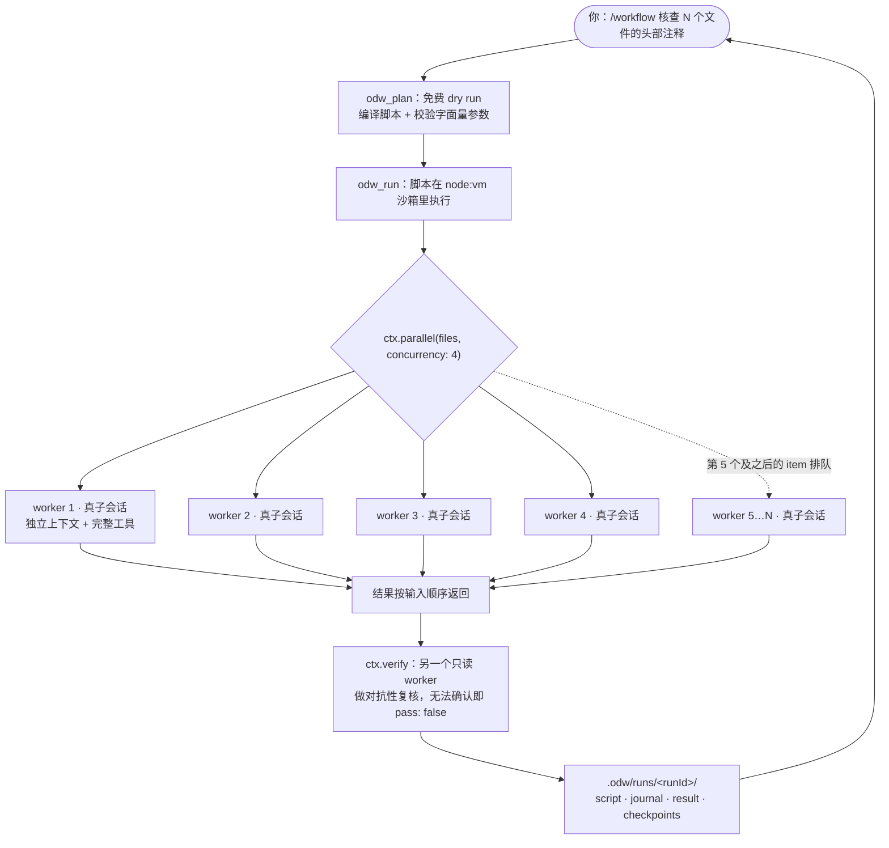

<div align="center">

# opencode-dynamic-workflow (ODW)

**把动态工作流做进 opencode v2 的一等公民**：模型写一个受约束的脚本，插件确定性地执行它，每个 worker 都是宿主 opencode 的一个真子会话。

<br>


[English](README.md) · **简体中文**

</div>

## 它是什么

ODW 面向三类工作：**对 N 个对象做同一件事**、**先扇出再汇总**、**循环到通过为止**。在一个会话里逐轮做这类事，速度慢、强制串行、而且不可复现；写成脚本之后，并发、预算、取消以及"到底发生了什么"的记录，都由插件承担。

ODW **不需要 API key**。所有模型调用都发生在宿主 opencode 的子会话里，用的是你已经登录的 provider 凭据。

```
/workflow 核查 workflows/ 下每个脚本的头部注释是否与实现一致
   │
   ├─ odw_plan   免费 dry run：编译脚本，按活体清单校验字面量参数
   ├─ odw_run    真执行：每个 ctx.agent 起一个真子会话
   └─ 产物       .odw/runs/<runId>/：result.json · journal.jsonl
```

## 多个子 agent 是怎么跑的

脚本在 `node:vm` 沙箱里执行，沙箱里只有 `ctx` 这一个对象。**每调用一次 `ctx.agent`，插件就在宿主 opencode 里创建一个真子会话**（worker）：独立的上下文窗口、完整的工具集、各自的 token 计量，在会话树里挂在当前会话下面（`parentID`），可以折叠、可以事后翻阅。脚本本身不读文件、不跑命令、不问网络——凡是要碰外部的，都由一个 worker 去做并把结果带回来。

`ctx.parallel(items, fn, { concurrency })` 把同一条 `fn` 同时发到多个 item 上，默认并发 4；超出上限的 item 排队等待，结果**按输入顺序**返回，与完成的先后无关。



- worker 与父会话共享模型，除非脚本在该调用上显式给了 `model`（或 `effort`）。
- 并发、总 worker 数、步数、墙钟都有硬上限，超出即抛错，不静默截断。
- worker 的会话**不会被删除**，它们就是"每个 worker 做了什么"的一手证据。

## 安装

前提：opencode v2（用内嵌 Bun 直接加载 TypeScript），以及 `PATH` 里的 `node`；ODW 没有运行时依赖。

```sh
curl -fsSL https://raw.githubusercontent.com/wishflow/opencode-dynamic-workflow/main/scripts/odw-install.sh | sh -s -- --global
# 在本地检出里执行同一步，用的就是本地文件：
./scripts/odw-install.sh install --global
```

脚本分两件事做：插件走 opencode 自己的安装器写进配置（`opencode plugin add github:wishflow/opencode-dynamic-workflow`，包会被立刻拉取），skill 写成真实文件 `~/.config/opencode/skills/odw/SKILL.md`。装完**重启 opencode**（配置和插件在 server 启动时读取），然后确认：

```sh
opencode plugin list      # 应出现一行：odw  <commit>  github:wishflow/opencode-dynamic-workflow
```

> 安装器里的重试不是防御性噪声：观察到的 3 次里，`opencode plugin add` 有 2 次首跑失败，报的是瞬时 registry 错误（`No matching version found for @redis/json@6.3.1`、`Error: aborted`），紧接着重试就成功。

装进某个项目用 `./scripts/odw-install.sh install --local`。opencode 的 CLI 只改全局配置，所以 `--local` 由脚本自己写项目的 `opencode.json`（合并进 `plugins`，不动其它键），skill 落在 `<项目>/.opencode/skills/odw/SKILL.md`。它不预取包，opencode 下次启动时在后台装（首次约 2.5 分钟，期间插件不可用）；`opencode plugin list` 只看全局配置，项目级安装要看启动日志里的 `msg="loading plugin" ... entrypoint=...`。

## 运维

```sh
./scripts/odw-install.sh status    [--global|--local]   # 装了什么、是否仍然一致
./scripts/odw-install.sh update    [--global|--local]   # 刷新插件与 skill
./scripts/odw-install.sh rollback  [--global|--local]   # 撤销，回到之前的字节
```

- `status` 报告作用域、配置/skill/manifest 的路径、插件 spec 是否在册、skill 是否仍与安装时记录的摘要一致；不带 `--local` 时还会告诉你当前项目有没有本地安装。
- `update` 刷新 skill，并尽力跑一次 `opencode plugin update`（那条命令需要能连上 opencode 服务；失败只给一条警告）。
- `rollback` **先恢复文件、最后恢复配置**。这个顺序是刻意的：先恢复配置会开出一个"配置指向尚不存在的插件文件"的窗口，opencode 的插件注册表 reconcile 撞上会刷一串 `failed to load plugin ... ENOENT`。
- `--ref <ref>` 把下载固定到某个分支或标签，而不是 `main`。

## 用法

`/workflow <任务>` 是人工入口，它自己不执行任何东西：任务交给模型，由模型加载 `odw` skill、先 `odw_plan`（免费 dry run）、再 `odw_run`。执行的代码路径只有一条——工具——所以创建 worker 的地方也只有一处。命令只能从 TUI 或 `session.command` 进入；`opencode run "/workflow x"` 不会派发命令，它把整串当普通 user prompt 发出去，无头场景直接调 `odw_run`。

触发面是 `skills/odw/SKILL.md` 这个文件，而不是往 prompt 里注入东西。插件**不注册任何 prompt hook**、不改写你输入的内容；**何时**用 ODW 写在 skill 的 `description`，**怎么**驱动它写在正文。机制里没有关键词表，判断交给模型：2026-10-29 实测，同一个扇出型任务用英文、日文、韩文分别叙述，三次都自动加载了 skill 并跑出真实结果（`status: "ok"`）。

三个工具：

- **`tools.odw.plan`**（不调模型）：编译脚本，按活体清单校验字面量参数，报告"将要跑什么"。
- **`tools.odw.run`**（只在脚本内调模型）：真正执行。入参是 `{ script: 'async (ctx) => {...}' }` 或 `{ file: "audit.ts" }`（相对 `<项目>/workflows/` 解析），可选 `runId` / `concurrency`（默认 4，上限 10）/ `timeoutMs`（默认 600000）/ `budgetUsd` / `maxWorkers`（默认 50）。
- **`tools.odw.ping`**：存活自检。

沙箱里有且只有 `ctx`：

- **`ctx.agent(o)`** — 起一个真子会话，发 prompt，等它结束，返回文本；给了 `schema` 就返回解析后的对象。
- **`ctx.parallel(items, fn, {concurrency?})`** — 有界并发扇出，结果按输入顺序返回。
- **`ctx.pipeline(items, ...stages)`** — `parallel` 加每个 item 顺序通过的一条 stage 链，stage 拿到上一级的返回值。
- **`ctx.loop({max, body, until?, initial?})`** — 迭代；`max` 必填，`until` 成立即停；返回 `{iterations, state, stopped}`。
- **`ctx.verify(claim | o)`** — 让一个只读 worker 做对抗性复核，返回 `{pass, reasons}`，无法确认即 `pass: false`。
- **`ctx.checkpoint(label, data?)`** — 落一个持久标记（journal + `checkpoints/` 下的文件）。
- **`ctx.abort(reason?)`** / **`ctx.phase(name)`** / **`ctx.log(...)`** / **`ctx.budget()`** — 主动终止、进度、日志、目前的花费。

`ctx.agent` 的完整选项：

```ts
{
  prompt: string             // 必填、非空
  label?: string             // 进度、journal、子会话标题里用
  agent?: string             // opencode agent id，如 "explore" | "build"
  model?: string             // "provider/model" 或 "provider/model#variant"
  effort?: string            // 模型 #variant 的语法糖；不能与 model 同时给
  mode?: "agentic" | "oneshot"   // oneshot = 拒绝全部工具
  permissions?: "inherit" | "read-only" | "dangerous-full-access" | Permission[]
  schema?: object            // JSON Schema；回复按 JSON 解析
  timeoutMs?: number         // 单个 worker 的墙钟
}
```

**没有自动重试。** worker 失败就抛错，脚本随之中止；工具把结构化错误（`kind` + `message` + 现场目录）交回模型，由模型改脚本再跑。要重试，就用 `ctx.loop` 写。

## 边界与预算

脚本跑在 `node:vm` 里，注入的白名单**只有** `ctx` 和一个被重定向的 `console`。沙箱里没有 `require` / `import` / 动态 `import()`（无法加载模块）、没有 `process` / `fs` / `path` / `os`（读不到环境变量、碰不到文件、起不了子进程）、没有 `fetch` / `XMLHttpRequest` / `WebSocket`（没有网络）、没有定时器和宿主全局对象；`eval` / `new Function` 被 `codeGeneration:{strings:false}` 阻断（实测抛 `EvalError`）。

| 上限 | 默认 | 说明 |
|---|---|---|
| 单脚本墙钟 | 10 min | 每次原语调用前检查；同步死循环由 vm `timeout` 打断 |
| 并发 | **4**（上限 10） | 脚本的 `concurrency` 只能向下收 |
| 总 worker 数 | **50** | 超出抛 `worker-limit`，不静默截断 |
| 原语调用步数 | **500** | 每次 `agent`/`parallel`/`pipeline`/`loop`/`verify`/`checkpoint`/`log`/`phase` 记 1 步 |
| 预算 | 默认只统计 | 给了 `budgetUsd` 就**事后**判定：worker 一完成即累加，超出后停止派发（不杀正在跑的） |
| 取消 | `context.signal` | 触发后：停派发 → `interrupt` → `remove` |

**能力围栏不是安全边界。** 这一档防的是"模型写错代码"，不是"攻击者拿到任意代码执行"：`node:vm` 不是安全沙箱，`constructor` 链逃逸是已知的、这里**不防**的手法。所以正确用法是**脚本由模型写、由你过目、由插件执行**，而不是执行来路不明的脚本；真正兜底的是上面的上限、结构化错误和逐步留痕。能力门在启动时判定：`vm` 必须支持 `runInContext({timeout})` 且真能打断纯 CPU 死循环，否则这一档不成立——opencode 2.1.0（内嵌 Bun 1.4.2）实测四项全过。

**预算的金额语义还验证不了（实测）：** `budgetUsd` 在免费模型上拿不到证据——`compass/deepseek-v4.1-flash` 每次调用都上报 `cost = 0`（token 数非 0）。所以"超预算就停派发"这条链路只有单测覆盖；token 计数、`maxWorkers`、`maxSteps` 和并发上限都有真机证据。

**`mode: "oneshot"` 不是宿主强制的单轮。** opencode 的 `session.create` 没有"禁用工具"开关（已核 generated types），ODW 的做法是拒绝全部权限（`[{action:"*",resource:"*",effect:"deny"}]`，实测确实落到会话行上）并在 prompt 里说明没有工具。模型仍可尝试调用工具，会被拒，然后只能用 prompt 里已有的信息回答——实测让它读一个文件，它回答"本会话没有文件访问，请把内容贴给我"，没有编造；反过来，答案需要外部信息时，oneshot 就是错的工具，请用默认的 `agentic`。同一 prompt 的实测：`oneshot` 1.37s / 1050 input tokens，`agentic` 1.58s / 2116 input tokens（agentic 要多花工具描述的开销）。

## 运行产物

每次运行落一盘证据到 `<项目>/.odw/runs/<runId>/`：

```
.odw/runs/<runId>/
├── script.ts          # 实际执行的脚本源码（归一化之后）
├── meta.json          # runId / sessionID / directory / origin / 上限 / scriptHost
├── journal.jsonl      # 追加式事件流（run-start、worker-start、step、worker-end、run-end…）
├── result.json        # 机器可读结果：workers/steps/cost/tokens/returnValue/humanSummary…
└── checkpoints/       # ctx.checkpoint 落的文件（label 会消毒，防目录穿越）
```

**worker 会话不会被删。** 它们的 transcript 是"发生了什么"的一手证据，`parentID` 让它们在你的会话树里可折叠。

## 为什么选择 ODW

三者定位不同：ODW 把编排做进 opencode 插件进程内；[open-dynamic-workflows](https://github.com/Suraj1235/open-dynamic-workflows) 是自带 daemon 与多宿主适配器的独立引擎；[open-dynamic-workflow](https://github.com/travisliu/open-dynamic-workflow) 是编排外部 agent CLI 的本地 runner。下表只列可核实的事实，对方 README 未声明处一律标注。

| | **ODW**（本仓库） | **open-dynamic-workflows** | **open-dynamic-workflow** |
|---|---|---|---|
| 定位 | opencode v2 插件 | 独立引擎，配套多种宿主适配器 | 编排外部 agent CLI 的本地 runner |
| 编排者 | 模型写脚本，插件在宿主进程内执行 | 模型写 `execute()`，由 daemon 执行 | 脚本驱动外部 CLI；自身不实现 agent |
| 模型与凭据 | 复用宿主 opencode 的登录态，无需 key | 自带 key（`~/.odw/config.json`）或本地 Ollama | 复用各外部 CLI 的登录态 |
| 常驻进程 | 无 | 需要本地 daemon（localhost HTTP/WS） | README 未提及常驻服务 |
| 沙箱 | `node:vm` + 白名单注入，**明示不是安全边界** | QuickJS 编译到 WASM 隔离 | README 未声明 |
| 崩溃续跑 | 无；worker 会话保留作证据 | 有：SQLite + WAL、`--resume` | README 未声明 |
| 宿主覆盖 | 仅 opencode v2 | OpenCode、Cursor、Codex、Gemini CLI、Kimi、Zed/zcode、Antigravity、VS Code、shell、MCP | Codex、Gemini、Copilot、OpenCode、Antigravity、Pi、Cursor 的 CLI |
| 依赖与分发 | 运行时依赖 0；未发布 npm，从 GitHub 安装 | 运行时依赖 0（12 个子包）；未发布 npm，clone 安装 | 运行时依赖 6；已发布 `@travisliu/open-dynamic-workflow` |

**ODW**：接入成本最低，无 key、无 daemon、无运行时依赖；worker 是宿主真子会话，工具齐全、可折叠、可审计；运行产物全量落盘。代价是覆盖面窄：仅支持 opencode v2；没有续跑和跨运行缓存；`node:vm` 只防写错、不防逃逸；并发上限偏低（4，上限 10；总 worker 50）；命令没法从 `opencode run` 触发；还没发布 npm。

**open-dynamic-workflows**：宿主覆盖最广，崩溃续跑、WASM 沙箱、拓扑规划与对抗校验更完整。代价是要自带 key 并常驻 daemon，配置面和故障面更大。

**open-dynamic-workflow**：`npx` 即用，边界清晰（不实现自己的 agent，只做编排），并通过 provider 抽象和内置 mock provider 拿到确定性测试能力。代价是能力上限受各外部 CLI 的可用性与输出稳定性约束。

## 常见问题

<details><summary><b>需要 API key、订阅或常驻 daemon 吗？</b></summary>

都不需要。模型调用发生在宿主 opencode 的子会话里，用的是宿主已有的登录态和凭据；插件本身跑在 opencode 进程内，执行、并发、预算都在进程内完成。

</details>

<details><summary><b>会跑飞吗？</b></summary>

有硬上限：单脚本 10 分钟、并发 4（上限 10）、总 worker 50、原语调用 500 步。超出即抛错，不静默截断。

</details>

<details><summary><b>失败会自动重试、崩溃能续跑吗？</b></summary>

都不会。worker 失败即中止脚本，工具把结构化错误交回模型，由模型改脚本再跑；要重试就用 `ctx.loop` 表达。崩溃后要重跑整个脚本，但已完成的 worker 会话不会被删除，可以当排查证据。

</details>

<details><summary><b>只是讨论机制时会被触发吗？</b></summary>

skill 的 `description` 已排除单步任务和纯讨论；机制里没有关键词表，是否加载由模型判断。

</details>

<details><summary><b>支持哪些 agent 与模型？</b></summary>

`agent` 取 opencode 的 agent id（如 `explore`、`build`）；`model` 取 `provider/model` 或 `provider/model#variant`；`effort` 是 variant 的语法糖，不能与 `model` 同时给。

</details>

## 已知限制

- **命令不能从 `opencode run` 触发。** `opencode run "/workflow x"` 把整串当普通 user prompt 发出去；命令只能从 TUI 或 `session.command` 进入，无头场景直接调 `odw_run`。
- **`odw_plan` 不执行脚本。** 它只看字面量：`agent: someVar` 或者在 `parallel` / `loop` 里拼出来的调用点会被标成 `dynamic` 并跳过校验，所以真实 worker 数在计划阶段不可预测。
- **计划通过 ≠ 运行成功。** 逻辑错误、运行期失败、worker 数量，它都看不到。
- **免费模型给不出金额。** 见"边界与预算"里那条实测说明。
- **worker 继承会话的模型。** 除非脚本在该调用上传 `model`（或 `effort`）。会话本身跑在免费档时，每个 worker 都会撞 provider 配额，run 以 `kind: "internal"` 失败——用 `opencode run` 驱动 ODW 时请显式传 `--model`。

## 开发

```sh
npx tsc --noEmit                               # 类型检查（零构建，不需要转译产物）
npx vitest run tests/unit                      # 84 条单测
ODW_CONTRACT=1 npx vitest run tests/contract   # 62 条契约断言（真起 opencode）
node tests/contract/opencode-v2/run.mjs --keep # 留下现场以便排查
```

契约测试是**用 opencode 自己跑出来的行为快照**（`tests/contract/opencode-v2/CONTRACT.md`），不是 mock：它建一个临时 git 项目、写入探针与一个 skill fixture、`spawnSync` 起 `opencode run`，然后断言原始观察；它不读也不写你的 `~/.config/opencode`。

**开发回路的铁律：永远不要在本仓库里跑 opencode。** 它会自动发现插件，然后在你每改一笔时重载。契约 harness 已经这么做了（`mkdtemp` → `git init` → 写入 fixture → `spawnSync("opencode", ...)`，并显式设 `PWD=<临时项目>`；只设 `cwd` 会让 server 静默绑到错误的项目上）。

```
src/
├── index.ts                    # Plugin.define({id:"odw", setup})
├── types.ts                    # 错误族 + AgentOptions/RunContext/ScriptHost 契约
├── plugin/{tools,commands,guard}.ts
├── script/{host,host-vm,normalize,api-doc,plan}.ts
├── primitives/{agent,parallel,pipeline,loop,verify,index}.ts
├── worker/{agentic,result,lifecycle}.ts
├── runner/{runner,semaphore,budget,deadline,steps,journal}.ts
└── params/model.ts · artifacts/store.ts
skills/odw/SKILL.md             # 触发面：何时用 ODW，以及怎么驱动它
scripts/odw-install.sh          # install / update / status / rollback
tests/unit/ · tests/contract/   # 84 条单测 + 62 条契约断言
workflows/audit.ts              # file: 载体示例（pipeline + checkpoint + verify）
```

## 许可

MIT —— 见 [LICENSE](LICENSE)。
